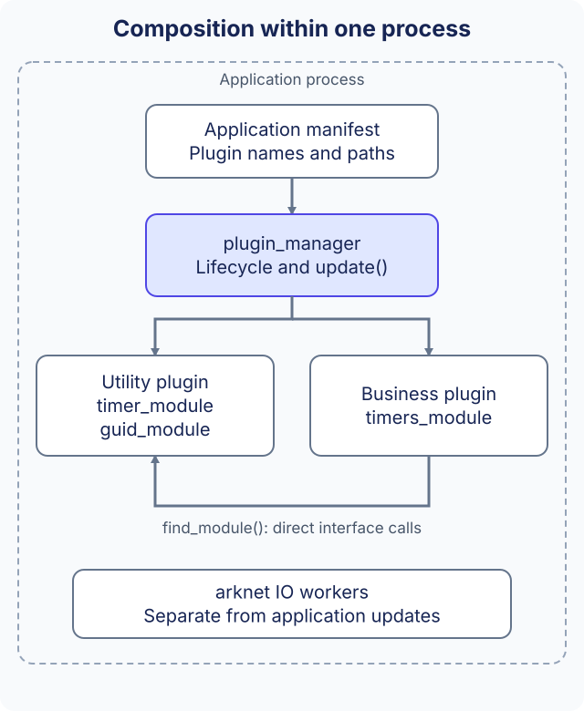

# Application architecture

An ark application is a process assembled from selected plugin libraries. A plugin can register several modules, and modules call each other through registered interfaces. Composition happens within the process; communication with another process uses the [Bus and network interfaces](../reference/bus.md).



## From manifest to modules

The launcher receives `--busid`, `--name` and `--app_conf`. The application manifest chooses shared-library names and optional per-plugin configuration filenames. The shipped `config/sample1.app.conf` is:

```xml
<xml>
    <plugins plugin_lib_dir="bin/" plugin_conf_dir="conf/">
        <plugin name="ark_utility_plugin" conf="" />
        <plugin name="sample1_plugin" conf="" />
    </plugins>
</xml>
```

New application manifests can use TOML; the equivalent [sample1.app.toml](https://github.com/OpenArkStudio/ark/blob/main/config/sample1.app.toml) is also supplied. A lowercase `.toml` suffix selects TOML, while the legacy `*.app.conf` entry selects XML. See [Application manifests](../service-manifests.md) for the full schema and validation rules; per-plugin and business-resource formats are unchanged.

The loader loads each library and calls its exported plugin entry. `sample1_plugin::install()` registers `sample1_module`; the utility plugin provides services such as timers. A module resolves those services with `find_module<timer_module>()`, rather than creating another copy of the utility plugin.

The manifest's names are runtime library names. Existing `ark_utility_plugin` / `sample1_plugin` names do not follow the C++ class spelling and must match the built artifacts. Debug libraries use the configured `_d` postfix. An empty `conf` supplies no configuration filename; the loader itself does not parse plugin-specific content.

## Paths and a runnable starting point

The existing launcher resolves these paths from its working directory. Library and plugin-configuration prefixes are concatenated with filenames, so retain the trailing separator in `bin/` and `conf/`. The manifest's location does not automatically become the base directory.

After following [installation](../get-started/installation.md) and preparing the runtime directory, run from `build/`:

```sh
./bin/app --busid=1.0.1.1 --name=sample1 --app_conf=conf/sample1.app.conf
```

The example's `init()` obtains timer and Guid modules; `post_init()` schedules a timer. Its update and shutdown methods demonstrate the module lifecycle. See [sample1_module.cpp](https://github.com/OpenArkStudio/ark/blob/main/examples/sample1/sample1_module.cpp) and the [quick start](../get-started/quick-start.md) for the runtime setup.

## Choosing the composition

| Application need | Include and initialize |
| --- | --- |
| Local timers or identifiers | Utility plugin and the corresponding module interfaces |
| Schema-backed entities | Kernel and its dependencies, metadata/configuration resources, maps and instances |
| Process messages | Bus/network plugins, process identity and endpoint configuration |
| Application behavior | An application-owned plugin that registers its business modules |

Adding a public header or CMake API target only makes an interface available to compile. Runtime configuration still has to load its owning plugin. Modules do not run in a separate process merely because they are in separate libraries.

## Ordering and ownership

The manager installs plugins before running the module initialization stages. It does not topologically sort module dependencies or make manifest list order a lifecycle-order contract. Missing-module lookups can return null, and module callback return values are not currently aggregated into a transactional startup result. Verify required plugins/resources and application logs; a running process alone does not prove every service initialized successfully.

Pointers returned by `find_module()` belong to the loaded plugin. Stop asynchronous producers before teardown and do not retain those pointers after unload. Keeping connections and state through an in-flight business-plugin replacement is not an automatic consequence of this composition model.

Continue with [framework boundaries](architecture.md), [module implementation](../guides/modules.md), or [Kernel data](../reference/kernel.md).
