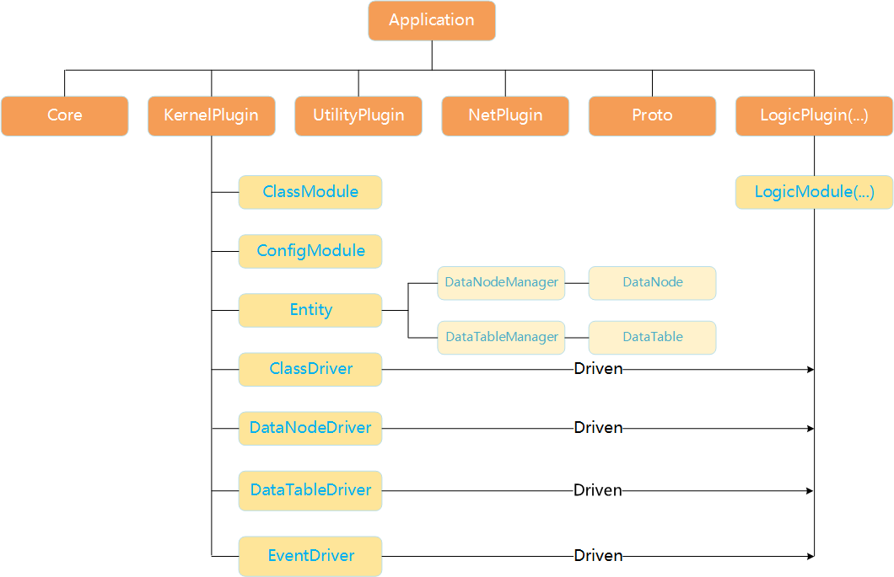

# Application architecture

An application consists of plugins, and each plugin contains modules. Modules call other modules through interfaces. This keeps business responsibilities separate and lets an application select its plugin composition.

Kernel manages Entity data. The [Kernel guide](../reference/kernel.md) explains data and events. The [framework architecture](architecture.md) describes application, plugin and module responsibilities.
