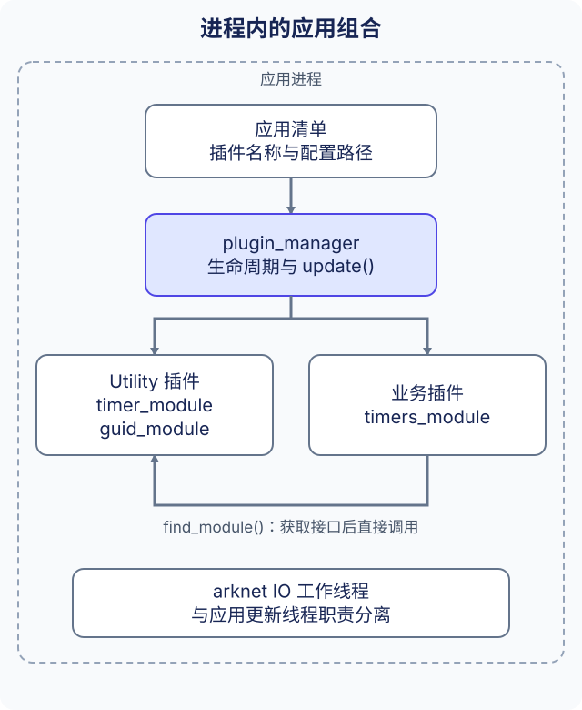

# 应用架构

ark 应用是由选定插件库组成的进程。一个插件可以注册多个模块，模块通过已注册的接口互相调用。这种组合发生在进程内；跨进程通信使用 [Bus 与网络接口](../reference/bus_CN.md)。



## 从清单到模块

启动器接收 `--busid`、`--name` 与 `--app_conf`。应用清单选择动态库名称，以及可选的插件配置文件名。仓库提供的 `build/conf/sample1.app.conf` 为：

```xml
<xml>
    <plugins plugin_lib_dir="bin/" plugin_conf_dir="conf/">
        <plugin name="AFUtilityPlugin" conf="" />
        <plugin name="Sample1Plugin" conf="" />
    </plugins>
</xml>
```

新的应用清单可以使用 TOML，仓库也提供等价的 [sample1.app.toml](https://github.com/OpenArkStudio/ark/blob/main/build/conf/sample1.app.toml)。小写 `.toml` 后缀选择 TOML，原有 `*.app.conf` 入口使用 XML。完整字段与校验规则见[应用清单](../service-manifests_CN.md)；插件专属配置和业务资源格式保持不变。

加载器依次加载库并调用导出的插件入口。`sample1_plugin::install()` 注册 `sample1_module`，Utility 插件提供定时器等服务。模块通过 `find_module<timer_module>()` 获取这些服务，不需要再创建一份 Utility 插件。

清单名称是运行时库名。现有 `AFUtilityPlugin`、`Sample1Plugin` 不等同于 C++ 类名拼写，必须与构建产物匹配。Debug 库使用配置的 `_d` 后缀。空 `conf` 不提供配置文件名，加载器本身不解析插件专属内容。

## 路径与运行入口

现有启动器从工作目录解析这些路径。库目录、插件配置目录前缀与文件名直接拼接，因此 `bin/`、`conf/` 需要保留末尾分隔符。清单所在目录不会自动成为相对路径基准。

按照[安装说明](../get-started/installation_CN.md)构建并准备运行目录后，在 `build/` 中执行：

```sh
./bin/app --busid=1.0.1.1 --name=sample1 --app_conf=conf/sample1.app.conf
```

示例在 `init()` 获取定时器和 Guid 模块，在 `post_init()` 注册定时器。更新与关闭方法展示模块生命周期。实现见 [sample1_module.cpp](https://github.com/OpenArkStudio/ark/blob/main/examples/sample1/sample1_module.cpp)，运行目录准备见[快速开始](../get-started/quick-start_CN.md)。

## 选择插件组合

| 应用需求 | 需要加载并初始化 |
| --- | --- |
| 本地定时器或标识生成 | Utility 插件及相应模块接口 |
| 带元数据的实体 | Kernel 及其依赖、元数据与配置资源、地图及实例 |
| 进程消息 | Bus、网络插件，进程标识与端点配置 |
| 应用行为 | 在应用仓库中提供业务模块的插件 |

包含公开头文件或依赖 CMake API 目标，只让编译器能使用接口；运行时仍需加载所属插件。模块不会因为分别位于不同动态库中，就自动运行在不同进程。

## 顺序与所有权

管理器先安装插件，再执行模块初始化阶段。它不按依赖关系排序模块，清单中的插件顺序也不是生命周期顺序保证。查找缺失模块可能返回空指针，模块回调返回值目前没有汇总为可回滚的启动结果。需要核对必需插件、资源和应用日志；进程仍在运行，不代表每个服务都已初始化成功。

`find_module()` 返回的指针属于已加载插件。释放前先停止异步生产者，插件卸载后不再保留这些指针。在业务函数执行期间替换插件，同时保留连接和状态，需要另外的协调机制，不是这种组合方式自动提供的能力。

继续阅读[框架边界](architecture_CN.md)、[模块实现](../guides/modules_CN.md)或 [Kernel 数据](../reference/kernel_CN.md)。
