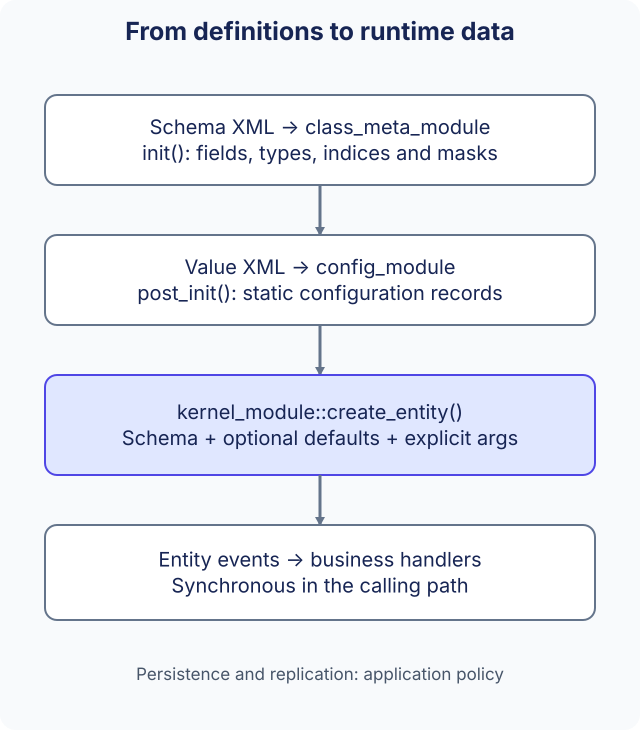

# Data-driven design

ark separates a class's schema, reusable configuration records and mutable runtime entities. Business modules use the Kernel interfaces to read or change that data and react to events. Changing a schema does not itself generate business rules, database writes or network replication.



## Three different kinds of data

| Kind | Defines or contains | Owner / access |
| --- | --- | --- |
| Metadata | Field names, indices, types, masks, table-row classes and container-child classes | `class_meta_module`, `class_meta` |
| Static configuration | Named class records indexed by configuration ID | `config_module`, `static_entity` |
| Runtime entity | An entity ID, class, mutable fields, tables and child entities | `kernel_module`, `entity` |

Metadata describes what values mean. A configuration ID identifies a reusable record, while an entity ID identifies one runtime object. Multiple entities can start from one configuration without sharing mutable node values. See [data structures](../guides/data-structures.md) for the APIs and ownership of each object.

## Loading resources

`class_meta_module` loads `resource/meta/config_class.config` and `resource/meta/entity_class.config` during `init()`. These lists reference schema files; configuration metadata can also reference value resources. `config_module` loads static records in `post_init()`, after metadata initialization.

These are paths under `resource/` in the process working directory. Legacy references beginning with `/` are still treated as resource-relative paths. They are business metadata/configuration XML, separate from the application's plugin manifest. The [configuration tool](../guides/tools.md) generates resources and C++ metadata indices; generated metadata files must be prepared for a real deployment and are not all supplied as tracked runtime output.

Keep field names, indices, types and generated `meta_define.hpp` consistent. A C++ naming cleanup does not authorize changing externally stored schema names or protocol field numbers.

## Creating an entity with defaults

Entity creation requires an existing class schema, map and map instance. A positive configuration ID must refer to a record of the same class. Configuration provides defaults; explicit initialization arguments take precedence for the same field, including zero and empty values. Unspecified fields keep configuration values.

This example sets `Player.level` to `0`. The caller has already created the map/instance and loaded a matching configuration record:

```cpp
#include <memory>

#include "ark/kernel/data_list_impl.hpp"
#include "ark/kernel/kernel_module.hpp"
#include "ark/meta_define.hpp"

std::shared_ptr<ark::entity> spawn_player(
    ark::kernel_module& kernel, int map_id, int instance_id, ark::id_type config_id) {
    ark::data_list_impl args;
    args.add_int(0);
    args.add_u_int(ark::entity_meta_player::level_index());
    return kernel.create_entity(
        ark::null_guid, map_id, instance_id, ark::entity_meta_player::self_name(), config_id, args);
}
```

Arguments are `(value, uint32_t field_index)` pairs, with exact schema types. Check the returned pointer before using the entity. Invalid schema/map/configuration, duplicate IDs or malformed arguments can fail creation. See [Kernel creation and defaults](../reference/kernel.md) for full examples and the restore-from-Protobuf distinction.

## Events and application policy

Defaults and arguments are established before the first creation event, `entity_evt_pre_load_data`. The ordinary create overload then dispatches its class events synchronously through `entity_evt_data_finished`. Field/table/container events let modules respond to changes; handlers run in the calling execution path, not on an automatically created business-event worker.

Register handlers before creating the relevant entities, and keep callback owners alive. Callback registration does not currently provide a general public unregister counterpart. Avoid holding pointers across entity/row destruction or modifying shared entity state directly from unrelated IO workers.

Masks describe persistence/synchronization intent, but declaring `save`, `sync_self` or `sync_view` does not configure a database, select recipients or guarantee delivery. The application still decides when to serialize, persist, synchronize and recover state. The [Kernel reference](../reference/kernel.md) documents callbacks and conversion APIs; [application architecture](application-architecture.md) explains module ownership.
