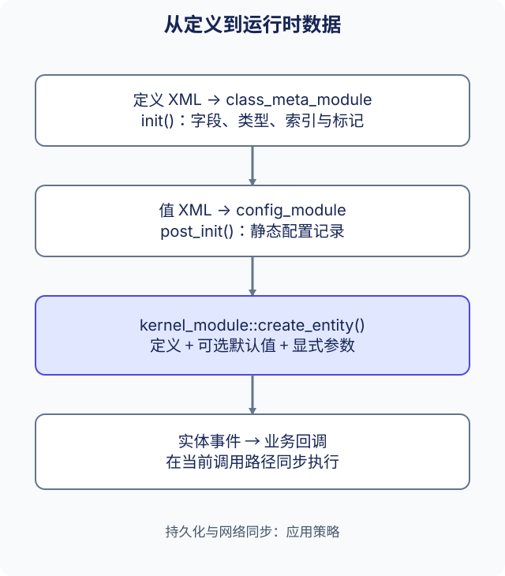

# 数据驱动

ark 将类定义、可复用的配置记录和可修改的运行时实体分开管理。业务模块通过 Kernel 接口读取或修改数据，并响应事件。修改元数据本身不会自动生成业务规则、数据库写入或网络复制。



## 三类数据

| 类型 | 定义或包含 | 管理与访问 |
| --- | --- | --- |
| 元数据 | 字段名、索引、类型、标记、表行类型与容器子实体类型 | `class_meta_module`、`class_meta` |
| 静态配置 | 按配置 ID 索引的类记录 | `config_module`、`static_entity` |
| 运行时实体 | 实体 ID、类、可变字段、表格与子实体 | `kernel_module`、`entity` |

元数据说明值的含义。配置 ID 标识可复用记录，实体 ID 标识一个运行时对象。多个实体可以从同一配置初始化，而不共享可变节点值。各对象的 API 与所有权见[数据结构](../guides/data-structures_CN.md)。

## 加载资源

`class_meta_module` 在 `init()` 加载 `resource/meta/config_class.config` 和 `resource/meta/entity_class.config`。这些清单引用各个定义文件，配置元数据还可以引用值资源。`config_module` 在元数据初始化之后的 `post_init()` 加载静态记录。

路径位于进程工作目录下的 `resource/` 中。旧引用即使以 `/` 开头，也按资源相对路径处理。这些文件是业务元数据与配置 XML，独立于选择插件的应用清单。[配置工具](../guides/tools_CN.md)生成资源及 C++ 元数据索引；真实部署需要准备生成文件，仓库没有跟踪全部运行时生成产物。

字段名、索引、类型与生成的 `meta_define.hpp` 必须保持一致。统一 C++ 命名，不代表可以改变外部存储中的定义名称或协议字段编号。

## 使用配置默认值创建实体

创建实体前需要存在类定义、地图与地图实例。正数配置 ID 必须指向同类记录。配置提供默认值，显式初始化参数覆盖同名字段，包括零值与空值；未指定字段保留配置值。

下例将 `Player.level` 设为 `0`。调用前已经创建地图与实例，并加载匹配的配置记录：

```cpp
#include <memory>

#include "ark/kernel/data_list_impl.hpp"
#include "ark/kernel/kernel_module.hpp"
#include "ark/meta_define.hpp"

std::shared_ptr<ark::entity> spawn_player(
    ark::kernel_module& kernel, int map_id, int instance_id, ark::id_type config_id) {
    ark::data_list_impl args;
    args.add_int(0);
    args.add_u_int(ark::entity_meta_player::level_index());
    return kernel.create_entity(
        ark::null_guid, map_id, instance_id, ark::entity_meta_player::self_name(), config_id, args);
}
```

参数为 `(value, uint32_t field_index)` 配对，类型必须与定义完全一致。使用实体前检查返回指针。缺失定义、地图或配置、重复 ID，以及错误参数都可能导致创建失败。完整示例及 Protobuf 恢复路径的区别见 [Kernel 创建与默认值](../reference/kernel_CN.md)。

## 事件与应用策略

默认值和参数在首个创建事件 `entity_evt_pre_load_data` 前准备完成。普通创建重载随后同步分发类事件，直到 `entity_evt_data_finished`。字段、表格与容器事件让模块响应变化，回调在当前调用路径中执行，不会自动创建业务事件线程。

在创建相关实体前注册回调，并保持回调所属对象存活。当前回调注册接口没有通用的公开注销方法。实体或行销毁后不再使用原指针，也不要从无关 IO 工作线程直接修改共享实体状态。

标记描述持久化或同步意图，但声明 `save`、`sync_self`、`sync_view` 不会自动配置数据库、选择接收者或保证交付。何时序列化、持久化、同步与恢复，仍由应用决定。[Kernel 参考](../reference/kernel_CN.md)说明回调与数据转换 API，[应用架构](application-architecture_CN.md)说明模块所有权。
