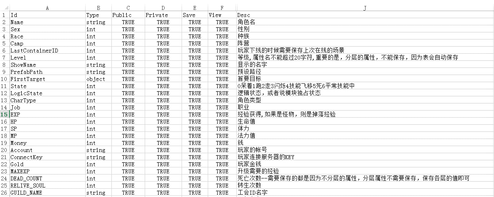

# 数据驱动

ark 将元数据、配置与运行时 Entity 的值分开管理。元数据描述字段与表结构，配置提供取值，模块通过 Entity 事件与数据事件组织业务逻辑。

[数据结构](../guides/data-structures_CN.md)介绍 Node、Table 和 Container 的关系，[Kernel](../reference/kernel_CN.md)介绍事件注册与数据访问。配置生成流程见[配置工具](../guides/tools_CN.md)。
