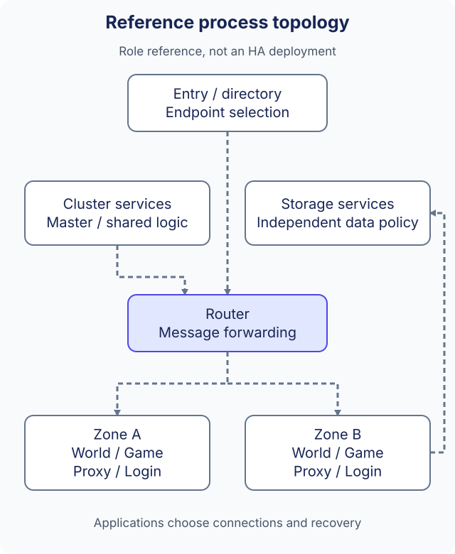

# Server architecture

ark can assemble different server processes from the same plugin/module interfaces. The topology below is a reference for assigning responsibilities in a multi-process deployment. It is not a turnkey cluster, an implemented Registry service, or a measured capacity result.

## Separate roles before scaling

| Reference role | Responsibility | Application decisions |
| --- | --- | --- |
| Entry / directory | Direct a client to an environment or entry endpoint | Authentication, endpoint selection and discovery source |
| Cluster services | Coordinate work shared across zones, such as a master or shared business service | Ownership, state recovery and failover |
| Router | Forward selected messages between zone and cluster processes | Destination IDs, allowed routes, congestion handling |
| Zone services | Run a zone's world, game, proxy or login responsibilities | Sharding, player placement and zone boundaries |
| Storage services | Store application records independently from process routing | Data model, replication, durability and backup |

These roles need not be separate binaries for every application. Begin with the processes required by the workload; introduce a boundary when its ownership, scaling or failure behavior needs to differ. A plugin boundary alone is not a network or high-availability boundary.

## What the repository supplies

`src/server/` contains example process roles such as `master`, `router`, `world`, `game`, `proxy`, `login` and `dir`. Their corresponding `config/*.app.conf` manifests select plugins. A role's source directory and configuration demonstrate composition; they do not certify that every service in the reference topology is complete.

The Bus plugin represents process addresses and routing destinations. Use the [Bus reference](../reference/bus.md) to configure local process relationships, create a connection, and send a message with the required identifiers. The [network plugin](../reference/network.md) supplies transport integration. Module-to-module calls inside a process continue to use direct interfaces, as shown in [application architecture](application-architecture.md).

## Start from a verified pair

1. Prepare one application's runtime directory using the [quick start](../get-started/quick-start.md).
2. Give each process its own Bus identity, manifest and endpoints. A shared library filename is not a process identity.
3. Verify a local client/server or Bus connection with a small workload and inspect both sides' logs before adding routing layers.
4. Add multiple zones or routers only with explicit ownership and recovery rules. Keep the target workload and failure tests with the deployment configuration.

Discovery is a separate integration decision. The framework does not require every deployment to start Consul. Configuration-driven endpoints, platform discovery and an optional integration have different operational requirements; none makes a custom multi-node Registry or automatic failover already available. See the [routing design proposal](../project/network-design.md) for the historical cluster/router/zone concept, not a released HA contract.

## Limits to verify in a deployment

Endpoint connectivity alone does not verify authentication, message delivery after reconnect, state transfer, split-brain behavior or storage consistency. The 100,000–200,000 concurrent-user target is a multi-process deployment goal, not a measured single-process limit. [Benchmarks and acceptance](../performance/benchmark.md) distinguish local correctness/performance tools from cross-host capacity and endurance tests.
