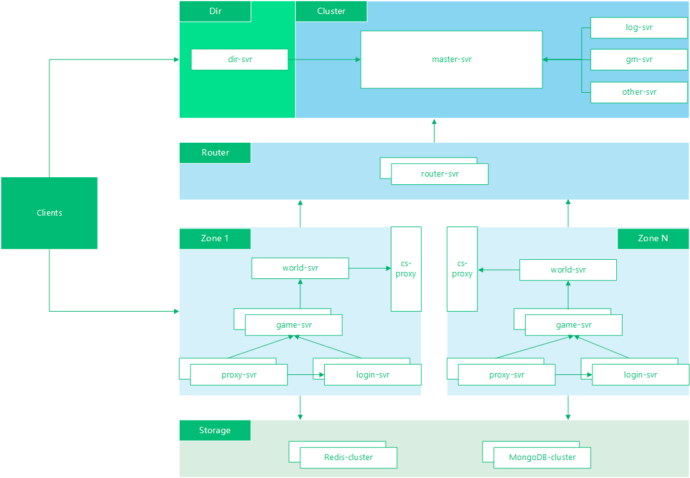

# Server architecture

This reference topology separates directory/discovery, cluster-wide services, routers, zones and storage. It illustrates process roles rather than a measured production capacity.

- Directory services identify the destination environment.
- Master and shared services operate at cluster scope.
- Routers bridge zones and shared services.
- World, game, proxy and login processes form each zone.
- Storage services have their own scaling and failure domains.

The [routing proposal](../project/network-design.md) explains the cluster/router/zone split. Concrete deployment, discovery and recovery policies require application-specific configuration and tests.
