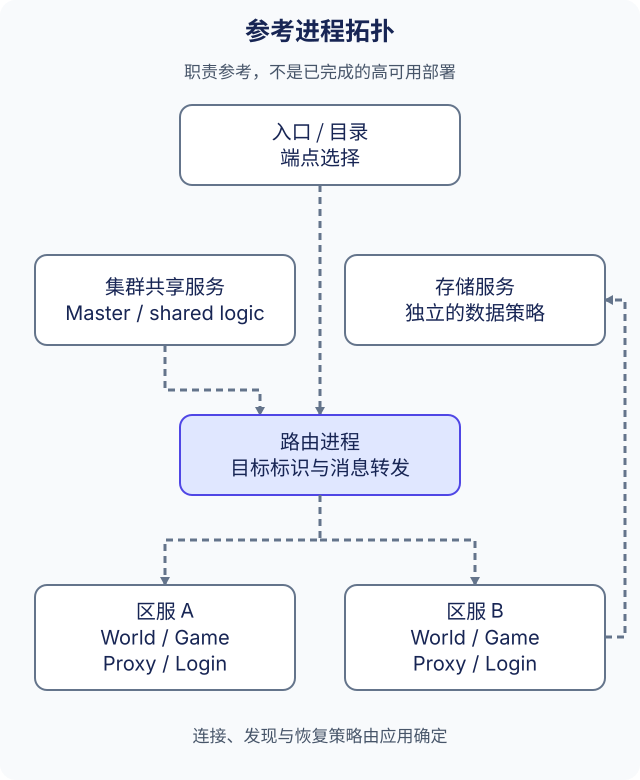

# 服务器架构

ark 可以使用同一组插件与模块接口组合不同的服务进程。下图用于为多进程部署分配职责，不表示已经提供开箱即用的集群、Registry 服务或实测容量。

## 先划分职责，再扩展规模

| 参考角色 | 职责 | 应用需要决定 |
| --- | --- | --- |
| 入口与目录 | 将客户端引导到环境或入口端点 | 鉴权、端点选择与发现来源 |
| 集群服务 | 协调跨区共享工作，例如 Master 或公共业务服务 | 状态归属、恢复与故障切换 |
| 路由进程 | 在区服与集群进程之间转发指定消息 | 目标标识、允许的路由与拥塞处理 |
| 区服服务 | 承担 World、Game、Proxy、Login 等职责 | 分片、玩家分配与区服边界 |
| 存储服务 | 独立于进程路由保存应用记录 | 数据模型、复制、持久性与备份 |

并非每个应用都需要为这些角色单独部署进程。先保留负载需要的进程，当状态归属、扩容或故障行为需要分离时，再增加边界。插件边界本身不等于网络边界或高可用边界。

## 仓库提供的内容

`src/server/` 包含 `master`、`router`、`world`、`game`、`proxy`、`login`、`dir` 等示例角色，`config/*.app.toml` 中的相应清单选择插件。角色目录与配置展示组合方式，不代表参考拓扑中的每种服务都已经完整实现。

Bus 插件表示进程地址与路由目标。[Bus 参考](../reference/bus_CN.md)说明如何配置本地进程关系、创建连接，以及携带所需标识发送消息；[网络插件](../reference/network_CN.md)提供传输集成。进程内的模块调用仍使用直接接口，见[应用架构](application-architecture_CN.md)。

## 从已验证的进程对开始

1. 按[快速开始](../get-started/quick-start_CN.md)准备一个应用的运行目录。
2. 为每个进程分别设置 Bus 标识、清单与端点。动态库文件名不是进程标识。
3. 先验证本机客户端与服务端或 Bus 连接，用小负载检查两端日志，再增加路由层。
4. 增加多个区服或 Router 前，明确状态归属与恢复规则，并将目标负载和故障测试保存在部署配置旁。

服务发现是独立的集成选型，框架并不要求每种部署都启动 Consul。配置文件端点、平台发现与可选集成各有运维要求；它们都不表示框架已经提供自研多节点 Registry 或自动故障切换。[路由设计提案](../project/network-design_CN.md)描述历史上的 cluster/router/zone 思路，不是已发布的高可用契约。

## 部署时需要验证的边界

端点可连通，不等于已经验证鉴权、重连后的消息交付、状态转移、网络分区行为或存储一致性。10 万至 20 万同时在线是多进程部署目标，不是实测的单进程上限。[基准测试与验收](../performance/benchmark_CN.md)区分本机正确性与性能工具，以及跨主机容量和耐久测试。
