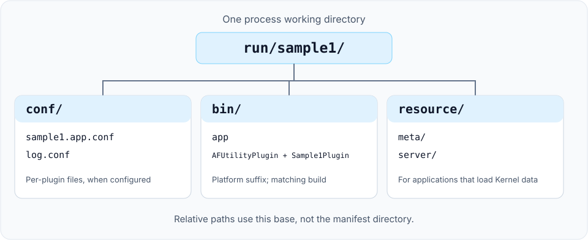

# Application launcher

The `app` executable selects a process identity, reads a TOML or XML application manifest and loads its plugin libraries. Start with the runnable [Sample1 quick start](../get-started/quick-start.md); this page explains configuration paths, library names and startup checks.

## Command-line arguments

| Argument | Required | Meaning |
| --- | --- | --- |
| `--busid` / `-b` | Yes | Logical process Bus address, such as `1.0.1.1`; this is not a socket bind address |
| `--name` / `-n` | Yes | Application name, also used in the log filename |
| `--app_conf` / `-a` | Yes | TOML application manifest with the lowercase `.toml` extension, or a legacy XML `*.app.conf` file |
| `--log_conf` / `-l` | No | Logger configuration; defaults to `./conf/log.conf` |
| `--help` / `-h` | No | Print the launcher's argument reference |

```sh
./bin/app --busid=1.0.1.1 --name=sample1 \
  --app_conf=conf/sample1.app.conf --log_conf=conf/log.conf
```

`busid`, `name` and `app_conf` must be supplied explicitly. The [Bus reference](../reference/bus.md) describes the address fields. Use the executable's `--help` output for additional platform-specific flags.

## Resolve configuration paths

Relative paths resolve from the process working directory. Moving the executable or placing the manifest in another folder does not change that base directory.



| Input | How it is selected | Example from the runtime directory |
| --- | --- | --- |
| Application manifest | `--app_conf` | `conf/sample1.app.conf` |
| Logger settings | `--log_conf`, or its default | `conf/log.conf` |
| Plugin libraries | TOML `plugin_library_dir` or XML `plugin_lib_dir`, plus the library filename | `bin/Sample1Plugin.dylib` on macOS Release |
| Per-plugin settings | TOML `plugin_config_dir` + `config`, or XML `plugin_conf_dir` + `conf` | `conf/my-plugin.conf` when the filename is `my-plugin.conf` |
| Kernel metadata and configuration | The Kernel's `resource/` directory | `resource/meta/entity_class.config`, `resource/server/item.config` |

The launcher passes the per-plugin path to the plugin manager; each module decides how to read its own configuration. Kernel resource paths are separate from the application manifest and are needed only by applications that use those Kernel facilities. See [Data-driven configuration](../concepts/data-driven.md) and [Configuration tools](tools.md).

## Select plugins

For a new manifest, use TOML. The equivalent of Sample1's XML configuration is checked in as [sample1.app.toml](https://github.com/OpenArkStudio/ark/blob/main/build/conf/sample1.app.toml):

```toml
[application]
plugin_library_dir = "bin/"
plugin_config_dir = "conf/"

[[plugins]]
name = "AFUtilityPlugin"

[[plugins]]
name = "Sample1Plugin"
```

Pass `--app_conf=conf/sample1.app.toml` to select it. The application table is required; directory fields are optional strings. Each plugin requires a unique, nonempty `name`; its optional `config` string selects a per-plugin file. See [Application manifests](../service-manifests.md) for validation rules and format boundaries. Bus, logger and business-resource configuration formats are unchanged.

### Existing XML manifests

The checked-in [Sample1 manifest](https://github.com/OpenArkStudio/ark/blob/main/build/conf/sample1.app.conf) loads a utility plugin and one sample plugin:

```xml
<xml>
    <plugins plugin_lib_dir="bin/" plugin_conf_dir="conf/">
        <plugin name="AFUtilityPlugin" conf="" />
        <plugin name="Sample1Plugin" conf="" />
    </plugins>
</xml>
```

- Keep the outer `xml` element: the launcher looks for its `plugins` child.
- Keep the trailing separator in directory prefixes such as `bin/` and `conf/`; the current loader concatenates strings.
- Use the library stem in `name`, without a platform suffix or a `lib` prefix. The loader appends `.dll`, `.so` or `.dylib`; Debug builds also append `_d` before the suffix.
- An empty `conf` value supplies no per-plugin filename. Sample1 does not need a separate `sample1.conf` file.

Copy the executable and selected plugin libraries from the same build. Keep Debug and Release artifacts in separate runtime directories. The plugin list is not a dependency-order contract: modules should resolve their dependencies through the [module API](modules.md), rather than rely on entry order.

## Check startup and stop the process

For Sample1, look for a log entry containing `sample1_module` and `PostInit`. This identifies entry into the sample's post-initialization callback, which registers its timer.

On macOS/Linux, Ctrl+C or `SIGTERM` requests shutdown through the application's main loop. On Windows, enter `exit` in the application console. The launcher first stops managed top-level task admission and continues module updates plus the shared owner-thread poll until accepted tasks finish. Their services and bridges remain available so those tasks can complete later awaits.

After task completion and the active callback stack returns, the manager waits for every module to report `ready_to_shut()`, then synchronously invokes shutdown hooks and unloading. A module must use its owner-frame readiness check to stop/drain native work and confirm native thread exit before allowing unload. When all hooks succeed, Sample1 logs `PreShut` and then `Shut`, and the launcher exits. A hook may block; the handler-count budget is not a shutdown-duration bound.

If a shutdown hook returns `false` or throws, the launcher reports its phase, module and available exception details once, keeps the process/resources alive, and does not continue unloading. `plugin_manager::update()` returning `false` or throwing during drain also locks the launcher into retention; owner updates continue where possible, but later completion cannot resume unloading.

`--shutdown_timeout_ms=N` configures a non-negative int64 wait in milliseconds; the default `0` waits indefinitely. A positive limit uses a monotonic clock and reports elapsed time, pending managed-task count and the waiting phase once. On expiry the process and resources stay alive, owner updates continue, and unloading remains disabled even if work completes later. This is a cooperative owner-loop wait limit: it cannot interrupt a blocking user `update()`, readiness check, shutdown hook or unload call. It is not a hard process-stop deadline, cancellation policy or successful shutdown. This managed-task drain does not prove that arbitrary callbacks, native pool workers or background cleanup have finished; see [module task integration](tasks.md#shared-business-executor-for-modules). Sample1's logs alone are not a readiness or shutdown guarantee for every plugin combination.

<Aside type="caution" title="Do not use process survival as the readiness check">

Manifest loading or validation failures return exit code `1` before plugin startup. If `plugin_manager::start()` returns `false`, the launcher reports a startup failure and returns `1` before entering the update loop or starting the Windows command thread. Completed startup work is not automatically rolled back. Argument parsing failures, including help handling, still return `0`. Check the expected module's initialization log and application-specific readiness before routing traffic to a process. A running PID or a zero exit status alone is insufficient.

</Aside>

## Troubleshoot startup

| Symptom | Check |
| --- | --- |
| Usage text or `Application parameter is invalid` | Supply all three required arguments; check spelling with `--help` |
| Manifest loading fails | Check the working directory, explicit path and format; a lowercase `.toml` suffix selects TOML, while legacy `*.app.conf` files use XML |
| Logger configuration cannot be read | Check the working directory and `--log_conf` path |
| `Load shared library[...] failed` | Check TOML `plugin_library_dir` or XML `plugin_lib_dir`, platform suffix, Debug suffix and the library's dependent shared libraries |
| Plugin loads but the expected module is unavailable | Check registration, enabled targets and required plugins; see [Create a plugin](plugins.md) |
| Kernel metadata or configuration is missing | Stage the generated `resource/meta/` and `resource/server/` files in the process working directory |

The launcher implementation is in [main.cpp](https://github.com/OpenArkStudio/ark/blob/main/src/app/main.cpp). Review existing multi-process scripts before adopting them: some retain older deployment paths and service assumptions.
