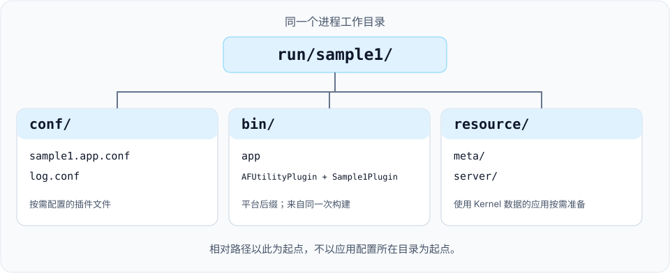

# 应用启动器

`app` 程序设置进程标识、读取 TOML 或 XML 应用配置，并加载所选插件的动态库。首次运行可先按 [Sample1 快速开始](../get-started/quick-start_CN.md)操作；本文说明配置路径、动态库命名和启动检查。

## 命令行参数

| 参数 | 必填 | 含义 |
| --- | --- | --- |
| `--busid` / `-b` | 是 | 进程的逻辑 Bus 地址，例如 `1.0.1.1`；不是 socket 绑定地址 |
| `--name` / `-n` | 是 | 应用名称，也用于日志文件名 |
| `--app_conf` / `-a` | 是 | 扩展名为小写 `.toml` 的 TOML 应用配置，或旧版 XML `*.app.conf` 文件 |
| `--log_conf` / `-l` | 否 | 日志配置，默认为 `./conf/log.conf` |
| `--help` / `-h` | 否 | 输出启动器的参数说明 |

```sh
./bin/app --busid=1.0.1.1 --name=sample1 \
  --app_conf=conf/sample1.app.conf --log_conf=conf/log.conf
```

`busid`、`name` 和 `app_conf` 都需要显式传入。地址各字段的含义见 [Bus 参考](../reference/bus_CN.md)。其他平台相关参数以程序的 `--help` 输出为准。

## 确定配置路径

相对路径以进程的工作目录为起点。移动程序，或把应用配置放到其他目录，都不会改变这个起点。



| 输入 | 选择方式 | 相对于运行目录的示例 |
| --- | --- | --- |
| 应用配置 | `--app_conf` | `conf/sample1.app.conf` |
| 日志配置 | `--log_conf`，或使用默认值 | `conf/log.conf` |
| 插件动态库 | TOML `plugin_library_dir` 或 XML `plugin_lib_dir` 加动态库文件名 | macOS Release 使用 `bin/Sample1Plugin.dylib` |
| 插件配置 | TOML `plugin_config_dir` + `config`，或 XML `plugin_conf_dir` + `conf` | 配置文件名为 `my-plugin.conf` 时，对应 `conf/my-plugin.conf` |
| Kernel 元数据和配置 | Kernel 使用的 `resource/` 目录 | `resource/meta/entity_class.config`、`resource/server/item.config` |

启动器把插件配置路径交给插件管理器，具体模块自行读取配置。Kernel 资源路径与应用配置路径相互独立，只有使用相关 Kernel 能力的应用才需要这些资源。详见[数据驱动配置](../concepts/data-driven_CN.md)和[配置工具](tools_CN.md)。

## 选择插件

新建应用配置可使用 TOML。仓库中的 [sample1.app.toml](https://github.com/OpenArkStudio/ark/blob/main/build/conf/sample1.app.toml) 与 Sample1 的 XML 配置等价：

```toml
[application]
plugin_library_dir = "bin/"
plugin_config_dir = "conf/"

[[plugins]]
name = "AFUtilityPlugin"

[[plugins]]
name = "Sample1Plugin"
```

通过 `--app_conf=conf/sample1.app.toml` 选择该文件。`application` 表必须存在，目录字段为可省略的字符串。每个插件的 `name` 必须非空且唯一；可选的 `config` 字符串指定插件配置文件。字段校验和格式边界见[应用配置清单](../service-manifests_CN.md)。Bus、日志和业务资源配置格式保持现有约定。

### 兼容已有 XML 配置

仓库中的 [Sample1 应用配置](https://github.com/OpenArkStudio/ark/blob/main/build/conf/sample1.app.conf)加载工具插件和一个示例插件：

```xml
<xml>
    <plugins plugin_lib_dir="bin/" plugin_conf_dir="conf/">
        <plugin name="AFUtilityPlugin" conf="" />
        <plugin name="Sample1Plugin" conf="" />
    </plugins>
</xml>
```

- 保留外层 `xml` 元素，启动器在其下查找 `plugins` 子元素。
- `bin/`、`conf/` 等目录前缀保留末尾分隔符，当前加载器直接拼接字符串。
- `name` 使用动态库名称主体，不加平台后缀，也不加 `lib` 前缀。加载器追加 `.dll`、`.so` 或 `.dylib`，Debug 构建还会在后缀前追加 `_d`。
- `conf` 为空表示没有提供插件配置文件名。Sample1 不需要单独的 `sample1.conf`。

程序和所选插件动态库应来自同一次构建，Debug 与 Release 文件分别放置。插件条目顺序不代表依赖初始化顺序；模块应通过[模块 API](modules_CN.md)查找依赖。

## 确认启动并停止进程

Sample1 的日志出现 `sample1_module` 和 `PostInit`，表示示例已经进入初始化后回调，该回调负责注册定时器。

macOS/Linux 可使用 Ctrl+C 或 `SIGTERM`，由应用主循环处理停止请求。Windows 在应用控制台输入 `exit`。启动器先停止受理新的顶层业务任务，继续执行模块更新与共享执行器轮询，直到已受理任务完成。任务使用的服务和桥接继续可用，以便协程完成后续等待。

任务完成且当前回调返回后，管理器等待所有模块的 `ready_to_shut()` 返回就绪，再同步执行关闭钩子与卸载。模块应在 owner frame 的就绪检查中停止并排空原生工作，确认原生线程退出后才允许卸载。所有钩子成功时，Sample1 依次输出 `PreShut` 和 `Shut`，随后启动器退出。钩子可能阻塞；handler 数量预算不代表停机耗时上限。

关闭钩子返回 `false` 或抛出异常时，启动器输出一次阶段、模块及可用的异常信息，保留进程和资源，不再继续卸载。排空期间的 `plugin_manager::update()` 返回 `false` 或抛出异常，也会锁定资源保留状态；启动器尽可能继续 owner 更新，但后续完成不能恢复卸载。

`--shutdown_timeout_ms=N` 设置等待时限，单位为毫秒，接受非负 int64 整数；默认值 `0` 表示无限等待。正数使用单调时钟计时，超时后输出一次实际等待时间、待完成的业务任务数和等待阶段。进程与资源继续保留，owner 更新继续运行；即使工作随后完成，也不再卸载。这是 owner loop 的协作式等待时限，不能中断阻塞中的用户 `update()`、就绪检查、关闭钩子或卸载调用，不构成强制进程退出期限、自动取消策略或成功停机。业务任务排空不证明外部回调、原生连接池线程或后台清理已经完成，详见[模块任务集成](tasks_CN.md#模块共用业务执行器)。仅凭 Sample1 的日志，不能推断所有插件组合都具备相同的就绪条件或停止保证。

<Aside type="caution" title="进程存在不等于应用就绪">

应用配置读取或校验失败时，启动器会在启动插件前返回退出码 `1`。`plugin_manager::start()` 返回 `false` 时，启动器会报告启动失败并返回 `1`，不进入更新循环，也不启动 Windows 命令线程；已经完成的启动工作不会自动回滚。参数解析失败（包括帮助处理）仍返回 `0`。接入流量前，应检查目标模块的初始化日志和应用自身的就绪条件，不能只判断 PID 存在或退出码为零。

</Aside>

## 排查启动问题

| 现象 | 检查项 |
| --- | --- |
| 输出帮助或 `Application parameter is invalid` | 补齐三个必填参数，用 `--help` 核对拼写 |
| 应用配置加载失败 | 检查工作目录、显式路径和文件格式；小写 `.toml` 后缀选择 TOML，旧版 `*.app.conf` 使用 XML |
| 日志配置无法读取 | 检查工作目录和 `--log_conf` 路径 |
| `Load shared library[...] failed` | 核对 TOML `plugin_library_dir` 或 XML `plugin_lib_dir`、平台后缀、Debug 后缀，以及动态库自身的共享库依赖 |
| 插件已加载，但目标模块不存在 | 核对模块注册、启用的构建目标和依赖插件，详见[创建插件](plugins_CN.md) |
| Kernel 元数据或配置缺失 | 在进程工作目录准备生成的 `resource/meta/` 和 `resource/server/` 文件 |

启动器实现见 [main.cpp](https://github.com/OpenArkStudio/ark/blob/main/src/app/main.cpp)。采用现有多进程脚本前先检查配置，部分脚本仍沿用旧部署路径和服务设置。
