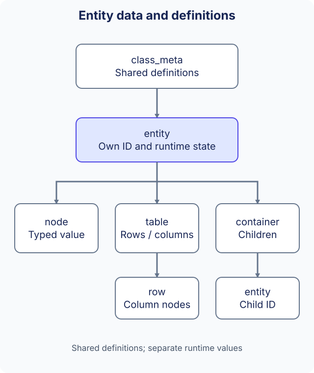

# Data structures and metadata

Use a node for one typed value, a table for rows with a shared schema, and a container for child entities. All three belong to the Kernel data model; their definitions are separate from their runtime values. This guide uses the current snake_case interfaces, not the historical AF-prefixed implementation layouts.

The public Kernel interfaces live in `include/ark/kernel/`. See [configuration tools](tools.md) for generated C++ and [Protobuf](../reference/protobuf.md) for protocol messages.



## Data definitions

| Definition | Describes | Runtime value |
| --- | --- | --- |
| `node_meta` | Field name, index, value type and masks | `node`, accessed through `entity` or `row` |
| `table_meta` | Table name/index, row class and masks | `table` with `row` objects |
| `container_meta` | Container name/index, allowed child class and masks | `container` holding child entities |
| `class_meta` | Class name, field-index mapping and the three definition collections | `entity` or configuration `static_entity` |

Metadata is shared description, not an entity's mutable state. A table's row class describes its columns. A container holds entities with their own IDs; it is not a table row or an untyped map. Choose the structure according to the operations and ownership the application needs.

## Find metadata before accessing values

The metadata module loads schema resources during initialization. Check that the class and field exist and use the accessor matching the declared type:

```cpp
#include <cstdint>
#include <string>

#include "ark/kernel/class_meta_module.hpp"

bool is_int32_field(ark::class_meta_module& schemas, const std::string& class_name, std::uint32_t index) {
    auto schema = schemas.find_meta(class_name);
    if (schema == nullptr)
    {
        return false;
    }
    auto field = schema->find_data_meta(index);
    return field != nullptr && field->get_type() == ark::data_type::dt_int32;
}
```

`entity::get_node_type()` checks a runtime field's declared type. Then use `get_int32()` / `set_int32()`, `get_string()` / `set_string()` or the corresponding typed accessor. Zero and an empty string are values, not reliable indicators that an entity or field is missing.

## Work with tables and rows

A table is created from its declared table metadata. The following function finds or adds one row and writes a known int32 column. The caller supplies schema indices; it does not create a schema or infer a column from the value.

```cpp
#include <cstdint>

#include "ark/kernel/entity.hpp"
#include "ark/kernel/table.hpp"

bool set_row_value(ark::entity& owner, std::uint32_t table_index,
    std::uint32_t row_index, std::uint32_t column_index, std::int32_t value) {
    auto* table = owner.find_table(table_index);
    if (table == nullptr || table->get_col_type(column_index) != ark::data_type::dt_int32)
    {
        return false;
    }
    auto* row = table->find_row(row_index);
    if (row == nullptr)
    {
        row = table->add_row(row_index);
    }
    return row != nullptr && row->set_int32(column_index, value);
}
```

`find_table()`, `find_row()` and `add_row()` return borrowed pointers. Do not retain a row after `remove_row()` or `clear()`, or retain a table after its entity is destroyed. Row IDs and column indices are different identifiers. A nonzero row ID selects a specific row; `add_row(0)` allocates a row ID. Register table callbacks before mutations when the application needs change notifications.

## Work with child entities

`entity::find_container(index)` returns a container object or null. Use `kernel_module::create_container_entity(parent_id, container_index, class_name, config_id)` to create a schema-compatible child. Check its return value; the parent, container definition, class and optional matching configuration must exist.

Use `container::find(slot)` or lookup by child ID to find placement. `place()` and `swap()` change placement; `remove()` and `destroy()` are distinct operations, so choose according to whether the application intends detachment or destruction. A retained `shared_ptr<entity>` is not proof that the entity remains registered in Kernel. Re-query its ID when live registration matters.

## Configuration and runtime ownership

`static_entity` is a loaded configuration record. `entity` adds runtime identity, mutable nodes, tables, containers and event behavior. Ordinary entity creation uses configuration as defaults and preserves explicit initialization arguments; later entity writes do not alter the original configuration record. See [data-driven creation](../concepts/data-driven.md).

`node_manager`, `table_manager` and `container_manager` organize the corresponding runtime collections. Applications normally use the public entity/table/container interfaces instead of depending on manager internals or `*_impl` member layouts. Borrowed pointers and callbacks do not make these objects safe for concurrent mutation from arbitrary threads.

## Data configuration generation

The existing [configuration tool](tools.md) generates XML metadata, static values and C++ field-index definitions. Keep them consistent when changing a schema. Field masks such as save/synchronization intent require application code to choose persistence and delivery policy; they are not automatic storage or replication.

The [Kernel reference](../reference/kernel.md) provides complete creation, typed access, callbacks and conversion examples. [Application architecture](../concepts/application-architecture.md) explains when the modules are available. Historical AF-prefixed layouts remain in [the original source article](https://github.com/OpenArkStudio/ark/blob/main/docs/site/legacy-source/en-us/data-structure.md); those private layouts are not the current API contract.
