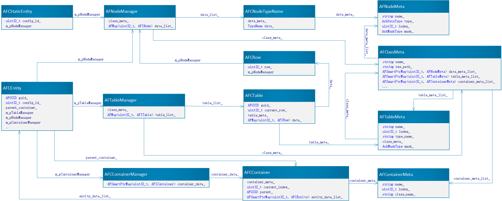

# Data structures and metadata

The separation of definitions and values remains: metadata describes field names, indices, types and flags; entities retain definitions and values. Public types now live in `include/ark/kernel/` with the snake_case names below. See [configuration tools](tools.md) for generated C++ and [Protobuf](../reference/protobuf.md) for protocol messages.

| Historical name | Current name |
| --- | --- |
| `AFNodeMeta` | `node_meta` |
| `AFTableMeta` | `table_meta` |
| `AFContainerMeta` | `container_meta` |
| `AFClassMeta` | `class_meta` |
| `AFIStaticEntity / AFCStaticEntity` | `static_entity / static_entity_impl` |
| `AFIEntity / AFCEntity` | `entity / entity_impl` |
| `AFNodeManager` | `node_manager` |
| `AFTableManager` | `table_manager` |
| `AFIContainer / AFCContainer` | `container / container_impl` |
| `AFITable / AFCTable` | `table / table_impl` |
| `AFIRow / AFCRow` | `row / row_impl` |

The original article's field descriptions, manager relationships and diagram are preserved below. Its AF-prefixed types and member layouts are historical implementation snapshots; use the corresponding public headers for current code instead of depending on those private layouts.

<details>
<summary>Original data-structure design and field reference</summary>

`ARK` separates data values from their definitions. A definition contains the name, index, type and flags such as whether the value is persisted. A data entity holds a pointer to its definition and the value itself. Object properties are stored as a mapping from indices to values.

## Data configuration generation

The `gen-config` tool in `build/tools` reads files from `build/resource/excel` and generates data definitions in `build/resource/meta` and configuration files in `build/resource/server`. It also generates interfaces for class property names and indices in `build/resource/code`.

### Data definitions

There are four data definition classes:

1. `AFNodeMeta` defines an object property.

- `name_`: property name, `string`
- `type_`: value type, `enum class ArkDataType`
- `index_`: index, `uint32`
- `mask_`: flags for persistence, synchronization and related features, `std::bitset`

2. `AFTableMeta` defines a table structure.

- `name_`: table name, `string`
- `index_`: index, `uint32`
- `type_name_`: name of the table's `AFClassMeta`, `string`
- `class_meta_`: corresponding `AFClassMeta`, `ARK_SHARE_PTR<AFClassMeta>`
- `mask_`: flags for persistence, synchronization and related features, `std::bitset`

3. `AFContainerMeta` defines a container that holds objects to form more complex data structures.

- `name_`: container name, `string`
- `index_`: index, `uint32`
- `class_name_`: class name of the objects stored in the container, `string`

4. `AFClassMeta` defines a class structure.

- `name_`: class name, `string`
- `res_path_`: resource path, string
- `name_index_list_`: mapping from field names to indices, `map`
- `data_meta_list_`: property map, `map`
- `table_meta_list_`: table map, `map`
- `container_meta_list_`: container map, `map`
- `class_meta_call_back_`: callback function, `pointer`

### Data entities

There are two data entity classes:

1. `AFCStaticEntity` represents configuration data and implements `AFIStaticEntity `.

- `config_id_`: configuration ID, `int`. It is stored separately because it is widely used and frequently accessed.
- `m_pNodeManager`: property manager, `ARK_SHARE_PTR<AFNodeManager>`

2. `AFCEntity ` represents an entity object and implements `AFIEntity `.

- `guid_`: unique identifier, `AFGUID`
- `config_id_`: configuration ID, `int`
- `parent_container_`: pointer to the owning container, `ARK_SHARE_PTR<AFIContainer>`
- `map_entity_id_`: map entity ID, `int`
- `custom_data_list_`: custom properties, `hashmap`. Properties can be added or removed without defining them in a file first.
- `m_pNodeManager`: property manager, `ARK_SHARE_PTR<AFNodeManager>`
- `m_pTableManager`: table manager, `ARK_SHARE_PTR<AFTableManager>`
- `m_pContainerManager`: container manager, `ARK_SHARE_PTR<AFIContainerManager>`
- `m_pEventManager`: event manager, `ARK_SHARE_PTR<AFIEventManager>`

These entities use the following classes:

- `AFNodeManager` manages an object's properties.

  ```cpp
      using DataList = AFMap<uint32_t, AFINode>;

      // class meta
      ARK_SHARE_PTR<AFClassMeta> class_meta_{nullptr};

      // call back
      NODE_COMPONENT_FUNCTOR func_;

      // data list
      DataList data_list_;
  ```

- `AFTableManager` manages tables, including creation and lookup.

  ```cpp
      using TableList = AFMap<uint32_t, AFITable>;

      // class meta
      ARK_SHARE_PTR<AFClassMeta> class_meta_{nullptr};

      // table list
      TableList table_list_;
  ```

- `AFIContainerManager`, implemented by `AFCContainerManager`, manages containers, including creation and lookup.

  ```cpp
      // container
      using ContainerList = AFSmartPtrMap<uint32_t, AFIContainer>;
      ContainerList container_data_;
  ```

- `AFIContainer`, implemented by `AFCContainer`, holds child objects to form complex structures.

  ```cpp
      using EntityDataList = AFSmartPtrMap<uint32_t, AFIEntity>;

      // contain entity class meta
      ARK_SHARE_PTR<AFContainerMeta> container_meta_{nullptr};

      // index start
      uint32_t current_index_{0u};

      // parent id
      AFGUID parent_{NULL_GUID};

      // entity data
      EntityDataList entity_data_list_;
  ```

- `AFIEventManager` handles an object's events.

- `AFINode`, implemented by `AFCNodeTypeName` (where `TypeName` is a built-in type name), holds a property value and its definition.

  ```cpp
      // meta
      ARK_SHARE_PTR<AFNodeMeta> data_meta_{nullptr};

      // value
      TypeName data_{TypeName()};
  ```

- `AFITable` is the table interface, implemented by `AFCTable`.

  ```cpp
      using TableData = AFMap<uint32_t, AFIRow>;

      // object unique guid
      AFGUID guid_{NULL_GUID};

      // table meta
      ARK_SHARE_PTR<AFTableMeta> table_meta_{nullptr};

      // current row
      uint32_t current_row{0u};

      // table data
      TableData data_;
  ```

- `AFIRow` is the table row interface, implemented by `AFCRow`.

  ```cpp
      // row
      uint32_t row_{0u};

      // data
      ARK_SHARE_PTR<AFNodeManager> m_pNodeManager{nullptr};
  ```

### Structure diagram



</details>
