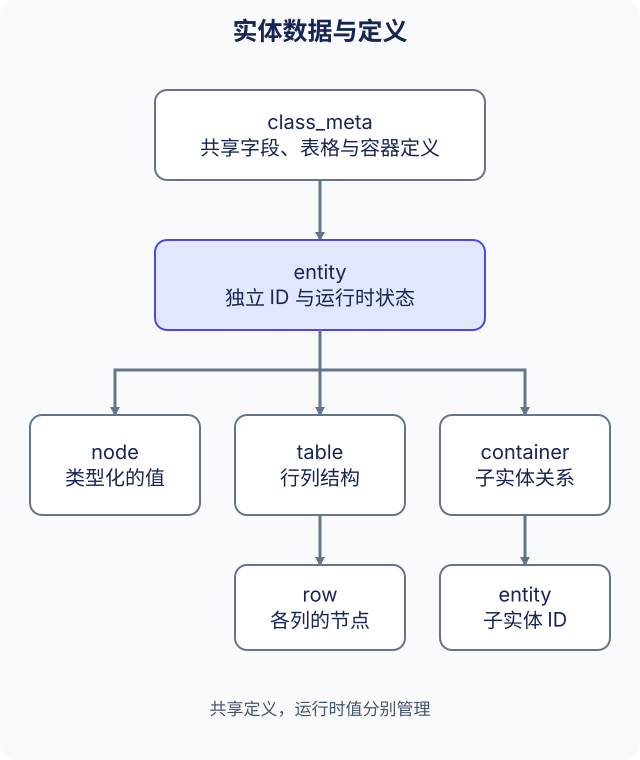

# 数据结构与元数据

单个类型化的值使用节点，结构相同的行使用表格，需要包含子实体时使用容器。三者都属于 Kernel 数据模型，定义与运行时值分别管理。本页使用当前 snake_case 接口，不依赖历史 AF 前缀的实现布局。



## 数据定义

| 定义 | 描述 | 运行时值 |
| --- | --- | --- |
| `node_meta` | 字段名、索引、值类型与标记 | `node`，通过 `entity` 或 `row` 访问 |
| `table_meta` | 表名、索引、行类型与标记 | 包含 `row` 的 `table` |
| `container_meta` | 容器名、索引、允许的子实体类型与标记 | 保存子实体的 `container` |
| `class_meta` | 类名、字段索引映射及上述三类定义集合 | `entity` 或配置 `static_entity` |

元数据是共享定义，不是某个实体的可变状态。表的行类型定义各列，容器中的实体则有各自的 ID；容器不是表行，也不是无类型字典。根据应用需要的操作与所有权选择结构。

## 访问值前先查定义

元数据模块在初始化时加载定义资源。先确认类与字段存在，再使用与定义类型匹配的访问接口：

```cpp
#include <cstdint>
#include <string>

#include "ark/kernel/class_meta_module.hpp"

bool is_int32_field(ark::class_meta_module& schemas, const std::string& class_name, std::uint32_t index) {
    auto schema = schemas.find_meta(class_name);
    if (schema == nullptr)
    {
        return false;
    }
    auto field = schema->find_data_meta(index);
    return field != nullptr && field->get_type() == ark::data_type::dt_int32;
}
```

`entity::get_node_type()` 可以检查运行时字段的定义类型，再使用 `get_int32()` / `set_int32()`、`get_string()` / `set_string()` 或相应类型接口。零值与空字符串都是合法值，不能据此可靠地判断实体或字段是否缺失。

## 操作表格与行

表格来自已经声明的表元数据。下列函数查找或新增一行，并写入已知的 int32 列。调用者提供定义中的索引，函数不会新建定义或根据值猜测列类型。

```cpp
#include <cstdint>

#include "ark/kernel/entity.hpp"
#include "ark/kernel/table.hpp"

bool set_row_value(ark::entity& owner, std::uint32_t table_index,
    std::uint32_t row_index, std::uint32_t column_index, std::int32_t value) {
    auto* table = owner.find_table(table_index);
    if (table == nullptr || table->get_col_type(column_index) != ark::data_type::dt_int32)
    {
        return false;
    }
    auto* row = table->find_row(row_index);
    if (row == nullptr)
    {
        row = table->add_row(row_index);
    }
    return row != nullptr && row->set_int32(column_index, value);
}
```

`find_table()`、`find_row()` 与 `add_row()` 返回借用指针。调用 `remove_row()`、`clear()` 后不再保留原行指针，所属实体销毁后也不再使用表指针。行 ID 与列索引是不同标识。非零行 ID 指定某一行，`add_row(0)` 则分配行 ID。需要变更通知时，在修改前注册表回调。

## 操作子实体

`entity::find_container(index)` 返回容器对象或空值。使用 `kernel_module::create_container_entity(parent_id, container_index, class_name, config_id)` 创建符合定义的子实体，并检查返回值；父实体、容器定义、类以及可选的同类配置必须存在。

使用 `container::find(slot)` 或按子实体 ID 查找放置位置。`place()`、`swap()` 修改放置关系，`remove()` 与 `destroy()` 是不同操作，需根据应用要移除关系还是销毁实体来选择。保留 `shared_ptr<entity>` 不代表该实体仍在 Kernel 中注册；需要确认存活注册时，应按 ID 再查一次。

## 配置与运行时所有权

`static_entity` 表示已加载的配置记录，`entity` 进一步提供运行时标识、可变节点、表格、容器和事件行为。普通实体创建使用配置作为默认值，并保留显式初始化参数；之后修改实体不会改变原配置记录。详见[数据驱动创建](../concepts/data-driven_CN.md)。

`node_manager`、`table_manager` 与 `container_manager` 管理相应运行时集合。应用通常通过实体、表格和容器公开接口操作，不依赖管理器内部或 `*_impl` 成员布局。借用指针与回调机制也不代表可以从任意线程并发修改对象。

## 数据配置生成

现有[配置工具](tools_CN.md)生成 XML 元数据、静态值与 C++ 字段索引定义。修改定义时保持三者一致。保存或同步标记仍需要应用决定持久化与交付策略，不会自动完成存储或复制。

完整创建、类型化访问、回调与转换示例见 [Kernel 参考](../reference/kernel_CN.md)，模块可用阶段见[应用架构](../concepts/application-architecture_CN.md)。历史 AF 前缀布局保存在[原始文章](https://github.com/OpenArkStudio/ark/blob/main/docs/site/legacy-source/zh-cn/data-structure.md)，这些内部布局不是当前 API 契约。
