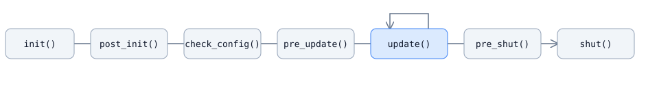

# 创建模块

模块通过 C++ 接口提供应用服务，插件负责创建和注册实现，插件管理器调用生命周期回调。实体访问、定时器和业务规则都可以作为模块；插件用于组合并安装一组模块。

下面将计数器接口与实现分开，并由另一个模块调用。配合[创建插件](plugins_CN.md)中的示例即可构建动态库。

## 定义接口与实现

将下面的代码保存为 `sample_module.hpp`：

```cpp
#pragma once

#include <cstdint>

#include <ark/module.hpp>
#include <ark/plugin_manager.hpp>

namespace ark {

class counter_module : public module
{
public:
    virtual void increment() = 0;
    virtual std::uint64_t value() const = 0;
};

class counter_module_impl final : public counter_module
{
    ARK_DECLARE_MODULE_FUNCTIONS

public:
    void increment() override {
        ++value_;
    }

    std::uint64_t value() const override {
        return value_;
    }

private:
    std::uint64_t value_ = 0;
};

class sample_module final : public module
{
    ARK_DECLARE_MODULE_FUNCTIONS

public:
    bool post_init() override {
        counter_module_ = find_module<counter_module>();
        return counter_module_ != nullptr;
    }

    bool update() override {
        if (counter_module_ == nullptr)
        {
            return false;
        }

        counter_module_->increment();
        return true;
    }

    bool pre_shut() override {
        counter_module_ = nullptr;
        return true;
    }

private:
    counter_module* counter_module_ = nullptr;
};

} // namespace ark
```

示例把三个类型放在同一个文件中，便于说明关系。应用项目应向调用方提供接口头文件，将实现细节保留在内部。两个实现类都使用 `ARK_DECLARE_MODULE_FUNCTIONS`；这个宏保存管理器指针和注册名称，并提供受保护的 `find_module<T>()` 方法。

## 使用同一个接口注册和查找

以 `counter_module` 为接口注册 `counter_module_impl`，再通过 `find_module<counter_module>()` 查找。注册键来自接口类型的 RTTI 名称；实现类名称和动态库文件名都是不同的键。同一个管理器中，每个接口只注册一个实现。注册宏不会把重复注册转换成受支持的多实现模型。

返回的指针由插件持有，调用方不拥有对象。不要删除这个指针，也不要在插件注销模块后继续使用。接口不存在或动态类型转换失败时，启用断言的构建会触发断言；关闭断言时，`find_module<T>()` 返回 `nullptr`。使用前应检查返回值，不要在 Debug 中通过失败查找探测可选服务。应用和插件需要使用兼容的头文件、编译器与 ABI 设置，并启用 RTTI。

示例中的两个模块在应用更新线程中调用。计数器没有使用原子变量，不支持任意工作线程直接访问。工作线程的完成结果应投递到模块所属线程，或使用服务明确提供的异步 API。网络回调的分发方式见[网络接口](../reference/network_CN.md)。

## 选择生命周期阶段

| 回调 | 适合处理的工作 | 当前约束 |
| --- | --- | --- |
| `init()` | 初始化本模块资源 | 其他已注册模块可能尚未执行 `init()` |
| `post_init()` | 查找接口，使用已在 `init()` 中初始化的依赖 | 其他模块的 `post_init()` 不按依赖顺序执行 |
| `check_config()` | 检查配置和依赖 | 管理器目前不汇总回调的布尔返回值 |
| `pre_update()` | 准备进入应用循环 | 避免在这个阶段执行无期限的工作 |
| `update()` | 处理当前帧的队列任务 | 只调用实现类覆盖的 `update()` |
| `pre_shut()` | 停止接收新任务，开始解除订阅 | 所有模块先完成这个阶段，再进入 `shut()` |
| `shut()` | 释放模块持有的资源 | 完成关闭回调后才卸载动态库 |



管理器先安装所有模块，再执行初始化阶段。每个阶段遍历已注册模块；当前容器不提供依赖排序，也不保证按照清单顺序执行。基类回调默认返回 `true`，只需覆盖使用到的阶段。注册宏检测到实现类覆盖 `update()` 时，才把它加入更新列表。因此计数器实现不参与逐帧更新，`sample_module` 则在每次管理器更新时递增一次计数器。

<Aside type="caution" title="回调返回值不会中止启动">

当前管理器忽略模块生命周期回调的布尔返回值，包括 `post_init()` 和 `update()`。关闭断言时，示例的空指针检查可以避免访问缺失的依赖；返回 `false` 不会让应用拒绝启动。部署时应完整配置依赖插件，并显式报告配置错误。

</Aside>

## 保证回调不超出对象生命周期

示例只保存其他模块的指针，并在 `pre_shut()` 中清空。实际模块还可能注册定时器、事件处理器或捕获 `this` 的异步操作。保存这些操作的标识符或取消句柄，先停止接收新任务，再按所属服务的 API 注销或取消，最后才销毁模块。不能仅凭取消操作推断所有完成回调都已执行。

管理器不会追踪任意回调，也不会证明所有使用插件的任务都已结束。不能根据 `pre_shut()`、`shut()` 或 `stop()` 返回成功，推断动态库可以安全替换，或所有回调都已排空。热更新不在本文范围内。

## 继续阅读

- [创建插件](plugins_CN.md)：配对注册、动态库入口、构建与运行选择。
- [应用启动器](applications_CN.md)：进程参数和配置路径。
- [Kernel 接口](../reference/kernel_CN.md)：官方模块提供的实体与数据服务。
