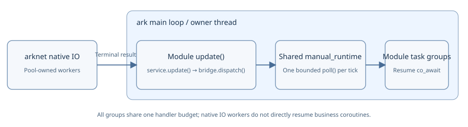

# Coroutine tasks

`<ark/task.hpp>` provides `ark::task<T>` and `ark::task_group`. Business modules can use the shared executor and module-owned groups provided by `plugin_manager`; standalone tools can still create their own runtime and groups.

`ark::task<T>` is an alias for Asio `awaitable<T>`; it adds no coroutine promise implementation. A group starts `task<void>` roots. A root can `co_await task<T>` to receive an owning value, just as it awaits other compatible Asio operations.

## Build and run the example

Initialize the existing dependencies using [Install and build](../get-started/installation.md). On macOS or Linux, run these commands from the ark source directory with the configured dependencies available:

```sh
cmake -S . -B task-build -G Ninja -DCMAKE_BUILD_TYPE=Debug \
  -DARK_BUILD_APPLICATIONS=OFF -DARK_BUILD_PROTO=OFF \
  -DARK_BUILD_CONFIG=OFF -DARK_BUILD_TESTS=OFF \
  -DARK_BUILD_CORE_TESTS=ON -DARK_BUILD_EXAMPLES=ON
cmake --build task-build --target ark_task_example check-task-sdk
./task-build/examples/task_group/ark_task_example
```

In PowerShell, use the same options on one line:

```powershell
cmake -S . -B task-build -G Ninja -DCMAKE_BUILD_TYPE=Debug -DARK_BUILD_APPLICATIONS=OFF -DARK_BUILD_PROTO=OFF -DARK_BUILD_CONFIG=OFF -DARK_BUILD_TESTS=OFF -DARK_BUILD_CORE_TESTS=ON -DARK_BUILD_EXAMPLES=ON
cmake --build task-build --target ark_task_example check-task-sdk
.\task-build\examples\task_group\ark_task_example.exe
```

Add the dependency toolchain/prefix options used for the rest of the project when required. The default uses Boost.Asio; core-only task builds also support `-DASIO_STANDALONE=ON`. `ARK_BUILD_EXAMPLES=ON` builds this ordinary executable even with applications disabled; it requires no plugin DLL, generated Protobuf messages or database server.

The [complete example](../../examples/task_group/main.cpp) returns `result=42 completed=1`. It starts one coroutine, closes top-level admission, and keeps polling until that accepted task finishes. Its two-second failure guard terminates the sample with code 2 instead of destroying pending frames; it is not an application shutdown timeout or abandonment strategy.

A consumer whose CMake project already adds ark uses the public `ark::core` target:

```cmake
target_link_libraries(my_tasks PRIVATE ark::core)
```

The target propagates C++20, public include paths and arknet requirements. No private `src/plugins` include directory is needed. The task implementation remains in the public header.

## Start typed work on the owner thread

A typed child coroutine can suspend and return a value:

```cpp
#include <ark/task.hpp>

ark::task<int> next_value(int value) {
    co_await asio::post(asio::use_awaitable);
    co_return value + 1;
}

ark::task<> compute(int& result) {
    result = co_await next_value(41);
}
```

The example's `main()` creates a shared `arknet::manual_runtime` and a group, then submits `compute(result)` with a completion handler. The handler receives an `std::exception_ptr`, empty on successful completion. Keep referenced state alive until the task completes. Do not let a coroutine lambda outlive its closure; named coroutine functions with explicitly owned parameters make that lifetime easier to see.

Construct, operate and destroy the runtime and group on the same thread. `manual_runtime` creates no worker to run task bodies or continuations: `poll()` runs ready Asio handlers on its constructing thread. Platform services such as timers or name resolution can use their own internal helper threads. Native database/network pools retain their separately documented IO ownership.

## Shared business executor for modules



Each manager owns one library-provided `manual_runtime`. After registering a module, call `manager.create_task_group(module, maximum)` during initialization, then submit work through `manager.get_tasks(module)`. Capacity must be positive; unknown modules, duplicate groups and creation after shutdown begins are rejected. A module pointer can be registered only once. Group references remain stable when other modules register.

Private database bridges use `manager.get_task_runtime()` to share that exact executor. A module's `update()` calls `service.update()` and `bridge.dispatch()` first; `manager.update(timestamp, maximum_handlers = 64)` then polls the runtime once. All groups share the handler budget. Modules must not also poll their group or runtime; a handler budget is not a frame-time limit. Published database plugins have not switched to these private bridges.

`manager.stop(timestamp)` stops top-level business-task admission in every managed group and returns `false` without waiting while tasks or an active update/completion stack remain. Accepted coroutines may submit later operations, so keep their services and bridges accepting. Only another `stop()` after task completion and stack unwinding enters shutdown hooks. It then executes `pre_shut()`, `shut()` and unloading synchronously; user hooks may block, so this API does not bound shutdown duration.

| State | Caller action |
| --- | --- |
| `running` | Update normally and accept tasks |
| `draining` | Continue module updates and the central poll; retain business state and services |
| `failed` | A shutdown hook returned failure or threw; do not continue unloading, and retain process/resources |
| `stopped` | Shutdown hooks completed; repeated `stop()` returns `true` |

Use `get_shutdown_state()`, `get_shutdown_failure()` and `get_shutdown_exception()` to distinguish waiting from failure. The launcher keeps pumping while tasks remain, and reports a hook failure once while retaining the process. There is no implicit shutdown timeout, cancellation, detach or frame destruction as a drain substitute. The pending-task check does not wait for completion. The poll budget limits handler count, not execution time, and does not bound user-hook or total shutdown latency.

Use the manager and its groups on their constructing thread. Do not mutate module registries or recursively update from update/shutdown hooks or executor callbacks. While any managed task is pending, no module can unregister: another module’s task may still borrow that provider. Destroying a manager with tasks, on an active callback stack or from another thread terminates; destruction is not a drain entry point.

<Aside type="caution" title="Task completion does not release native IO resources">

This drain check covers only top-level business tasks accepted by managed groups. Modules do not yet define a common phase for stopping incoming requests. External callbacks must return, connection-pool workers must exit and background cleanup must complete before their code can be safely unloaded. A zero task count does not prove those conditions or activate the public native database plugins. Unmanaged work must not reference a module being destroyed.

</Aside>

## API and admission

| API | Behavior |
| --- | --- |
| `task_group(runtime, maximum = 64)` | Keep the shared runtime alive and limit accepted root tasks; a null runtime or zero limit throws `std::invalid_argument` |
| `start(task<>, completion = {})` | Return a nonzero observation/cancellation ID, or zero if admission is full or stopped; a refused lazy task never starts and its completion handler is not called |
| `stop_accepting()` | Refuse new root tasks without cancelling or polling accepted work; repeated owner-thread calls are harmless |
| `cancel(id)` / `cancel_all()` | Request terminal cancellation; accepted tasks remain owned until their real completion |
| `close()` | Stop admission and request cancellation; does not poll or wait |
| `poll(maximum = 64)` | Run at most this many ready handlers on the shared runtime without waiting; zero does no work |
| `pending()` | Count accepted root tasks whose completion has not retired |
| `closed()` | True only when admission has stopped and no accepted root tasks remain |

Dropping an ID does not cancel its task. Dropping an unstarted `task<T>` performs no coroutine body work. A task-body exception reaches the optional completion handler; it is not a successful result. Exceptions thrown by user completion handlers propagate from `poll()`.

Polling the shared runtime can run handlers belonging to other groups or operations on that runtime. The handler limit is not a task-step count, an elapsed-time budget or a guarantee that user work finishes within a frame. Reentrant runtime polling is rejected. Calls on a different thread throw `std::logic_error`; the destructor contract below is stricter.

## Finish accepted work before destruction

For natural completion, call `stop_accepting()` and continue the usual owner update sequence. Accepted tasks may perform further awaits. Their underlying services and operation bridges must remain available and accepting if those tasks need to submit their next operation.

For cancellation, call `close()` and continue driving every required service completion, bridge dispatch and runtime poll until the tasks have actually finished. Cancellation support depends on the awaited operation and coroutine code; a request does not forcibly destroy a frame or establish that a remote write did not happen.

<Aside type="caution" title="Destruction requires an empty owner">

Destroy a group only on its constructing thread and with `pending() == 0`. A pending-task or wrong-thread destruction calls `std::terminate`. Destruction does not detach work, recursively poll or block until completion. Keep the runtime, awaited-operation owners and state referenced by coroutines alive for the required duration.

</Aside>

The last completion retires its group membership before invoking user completion code, so that handler may destroy the now-empty group facade. This does not allow destroying unrelated outstanding operations. `closed()` describes this group's tracked roots; it is not a transport drain, callback barrier, DLL-unload guarantee or completed module shutdown design.

All plugins must be rebuilt against the same updated manager headers; this change does not provide a stable binary plugin ABI or hot-update compatibility.

## Continue

- [Create a module](modules.md): lifecycle callbacks and borrowed module interfaces.
- [Create a plugin](plugins.md): plugin registration, build and runtime selection.
- [Database coroutine tests](../../tests/database/COROUTINES.md): private native-operation bridges, owner update order and explicit test teardown; public database plugins are still separate work.

Code deriving directly from the scheduler helper base should use `ark::scheduler_task`. `ark::task<T>` denotes an Asio coroutine; `ark::scheduler` scheduling calls keep their existing signatures.
