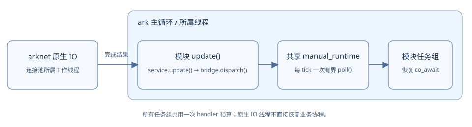

# 协程任务

`<ark/task.hpp>` 提供 `ark::task<T>` 和 `ark::task_group`。业务模块可通过 `plugin_manager` 使用统一的任务执行器和模块任务组；独立工具仍可显式创建 runtime 和任务组。

`ark::task<T>` 是 Asio `awaitable<T>` 的类型别名，没有自定义 coroutine promise。任务组启动返回 `void` 的顶层业务任务；顶层业务任务可以通过 `co_await task<T>` 获得拥有型返回值，也可以等待兼容的 Asio 异步操作。

## 构建并运行示例

先按[安装与构建](../get-started/installation_CN.md)初始化已有依赖。在 macOS 或 Linux 中，从 ark 源码目录运行以下命令，并提供已配置的依赖路径：

```sh
cmake -S . -B task-build -G Ninja -DCMAKE_BUILD_TYPE=Debug \
  -DARK_BUILD_APPLICATIONS=OFF -DARK_BUILD_PROTO=OFF \
  -DARK_BUILD_CONFIG=OFF -DARK_BUILD_TESTS=OFF \
  -DARK_BUILD_CORE_TESTS=ON -DARK_BUILD_EXAMPLES=ON
cmake --build task-build --target ark_task_example check-task-sdk
./task-build/examples/task_group/ark_task_example
```

PowerShell 使用相同选项，写成单行：

```powershell
cmake -S . -B task-build -G Ninja -DCMAKE_BUILD_TYPE=Debug -DARK_BUILD_APPLICATIONS=OFF -DARK_BUILD_PROTO=OFF -DARK_BUILD_CONFIG=OFF -DARK_BUILD_TESTS=OFF -DARK_BUILD_CORE_TESTS=ON -DARK_BUILD_EXAMPLES=ON
cmake --build task-build --target ark_task_example check-task-sdk
.\task-build\examples\task_group\ark_task_example.exe
```

如有需要，补上项目构建时使用的依赖 toolchain 或 prefix 选项。默认使用 Boost.Asio；仅构建核心任务时也支持 `-DASIO_STANDALONE=ON`。开启 `ARK_BUILD_EXAMPLES=ON` 后，即使关闭应用，也会构建这个普通可执行程序；它不需要插件动态库、生成的 Protobuf 消息或数据库服务。

[完整示例](../../examples/task_group/main.cpp)输出 `result=42 completed=1`。它启动一个协程后停止受理顶层业务任务，继续轮询直到已受理任务完成。示例中的两秒检查仅用于失败时以代码 2 结束测试程序，避免销毁尚未完成的协程；它不是应用停机超时或放弃任务的策略。

在已经通过 CMake 加入 ark 的项目中，使用公开目标 `ark::core`：

```cmake
target_link_libraries(my_tasks PRIVATE ark::core)
```

该目标传递 C++20、公开头文件路径和 arknet 依赖要求，无须加入私有的 `src/plugins` 目录。任务实现在公开头文件中。

## 在所属线程启动有返回值的任务

子协程可以挂起并返回一个值：

```cpp
#include <ark/task.hpp>

ark::task<int> next_value(int value) {
    co_await asio::post(asio::use_awaitable);
    co_return value + 1;
}

ark::task<> compute(int& result) {
    result = co_await next_value(41);
}
```

示例的 `main()` 创建共享的 `arknet::manual_runtime` 和任务组，再提交 `compute(result)` 及完成回调。回调接收 `std::exception_ptr`，正常完成时为空。协程引用的状态必须存活到任务结束。协程 lambda 不能在闭包销毁后继续引用其捕获；使用具名协程函数，并明确参数的所有权，更容易检查生命周期。

runtime 和任务组必须在同一线程构造、操作和销毁。`manual_runtime` 不创建执行任务体或恢复协程的工作线程，而是在构造线程调用 `poll()` 时执行就绪的 Asio handler。定时器或名称解析等平台服务可能使用内部辅助线程。原生数据库或网络连接池的 IO 所有权仍由各自接口定义。

## 模块共用业务执行器



每个管理器拥有一个网络库提供的 `manual_runtime`。在模块注册后的初始化阶段调用 `manager.create_task_group(module, maximum)`，之后用 `manager.get_tasks(module)` 提交业务任务。组上限必须大于零；未注册模块、重复创建或关闭开始后创建都会拒绝。一个模块指针只能注册一次，组引用在其他模块注册时保持稳定。

私有数据库桥接使用 `manager.get_task_runtime()`，从而与业务任务使用同一执行器。模块的 `update()` 先调用 `service.update()` 和 `bridge.dispatch()`；随后 `manager.update(timestamp, maximum_handlers = 64)` 统一轮询一次。多个组共用该 handler 上限。模块不再自行调用组或 runtime 的 `poll()`，handler 上限也不表示单帧耗时上限。公开 MySQL 与 Redis 插件在内部使用这些桥接接口。

`manager.stop(timestamp)` 先停止所有模块组受理顶层业务任务，仍有任务或正在执行更新/完成回调时，不等待它们完成，直接返回 `false`。已受理协程可以继续发起后续操作，因此此时不能关闭其 service 或 bridge 的准入。任务完成且外层回调返回后，再次调用 `stop()` 才同步执行 `pre_shut()`、`shut()` 和卸载。用户钩子可能阻塞，因此该接口不保证停机耗时上限。

| 状态 | 调用方处理 |
| --- | --- |
| `running` | 正常更新并受理任务 |
| `draining` | 继续模块更新与统一轮询，保持业务状态和服务存活 |
| `failed` | 关闭钩子返回失败或抛出异常；不继续卸载，保留进程和资源 |
| `stopped` | 关闭钩子完成；重复 `stop()` 返回 `true` |

通过 `get_shutdown_state()`、`get_shutdown_failure()` 和 `get_shutdown_exception()` 区分等待与失败。应用启动器在任务未完成时继续驱动主循环；钩子失败时输出一次原因并保留进程。本实现不设置隐含停机时限，也不以取消、分离任务或销毁协程替代排空。待完成任务的检查不会等待其结束；轮询预算只限制 handler 数量，不限制业务代码或关闭钩子的执行时间。

管理器及其任务必须在构造线程操作。更新/关闭钩子或执行器回调中不能增删模块或递归更新；只要管理器仍有任务，任何模块都不能注销，因为其他模块的任务可能仍引用该服务提供方。管理器在仍有任务、执行回调中或跨线程析构时会终止进程，析构不是排空入口。

<Aside type="caution" title="任务完成不等于 IO 资源已释放">

此排空检查只覆盖管理器组中受理的顶层业务任务。模块尚未统一定义停止接收新请求的阶段；还需等待外部回调返回、连接池线程退出和后台清理完成，才能安全卸载相关代码。任务数归零不证明这些条件已满足。不要让未受组管理的工作引用即将销毁的模块。

</Aside>

## API 与任务准入

| API | 行为 |
| --- | --- |
| `task_group(runtime, maximum = 64)` | 保持共享 runtime 存活，并限制已受理顶层业务任务数量；runtime 为空或上限为零时抛出 `std::invalid_argument` |
| `start(task<>, completion = {})` | 返回非零观察和取消 ID；达到上限或已停止受理时返回零，被拒绝的惰性协程不会启动，也不调用完成回调 |
| `stop_accepting()` | 停止受理新顶层业务任务，不取消或轮询已受理任务；在所属线程重复调用无副作用 |
| `cancel(id)` / `cancel_all()` | 请求 terminal cancellation；仍持有任务直到实际完成 |
| `close()` | 停止受理并请求取消，不轮询，也不等待 |
| `poll(maximum = 64)` | 在共享 runtime 上执行至多指定数量的就绪 handler，不等待；零表示不执行 |
| `pending()` | 返回已受理且尚未移除完成记录的顶层业务任务数量 |
| `closed()` | 只有停止受理且所有已受理顶层业务任务均已完成时才为真 |

丢弃任务 ID 不会取消任务。丢弃尚未启动的 `task<T>` 不会执行协程体。任务体的异常通过可选的完成回调传递，不会变成成功结果；用户完成回调抛出的异常会从 `poll()` 继续抛出。

轮询共享 runtime 时，也可能执行同一 runtime 上其他任务组或操作的 handler。handler 数量上限不是协程步骤数、耗时预算，也不保证业务代码在一帧内完成。runtime 不允许重入轮询。在其他线程调用操作会抛出 `std::logic_error`；析构的要求更严格，见下文。

## 任务完成后再销毁所属对象

如果希望自然完成，调用 `stop_accepting()` 后继续所属线程原有的更新流程。已受理任务可以继续执行后续 `co_await`；如果它们需要提交下一步操作，底层服务和操作桥接对象必须继续存活并受理操作。

如果需要取消，调用 `close()`，并继续驱动所需的服务完成通知、桥接分发和 runtime 轮询，直到任务实际完成。能否响应取消取决于异步操作和协程代码；取消请求不会强行销毁协程帧，也不能证明远端写入没有发生。

<Aside type="caution" title="任务组销毁前必须排空">

只能在构造线程销毁任务组，并且此时 `pending() == 0`。仍有任务或跨线程析构都会调用 `std::terminate`。析构不会分离任务、递归轮询或阻塞等待完成。runtime、异步操作所属对象及协程引用的状态都必须在所需期间继续存活。

</Aside>

最后一个完成回调会先移除任务组中的对应记录，因此该用户回调可以销毁已经为空的任务组对象；这不允许销毁仍有其他操作的对象。`closed()` 只描述本组跟踪的顶层业务任务，不代表传输层排空、回调屏障、动态库可卸载或模块停机流程已经完成设计。

所有插件都需要使用同一版本的管理器头文件重新构建；本改动不提供稳定的插件二进制 ABI 或热更新兼容保证。

直接继承调度器基类的代码应改用 `ark::scheduler_task`。`ark::task<T>` 表示 Asio 协程；`ark::scheduler` 的调度接口保持原有签名。

## 继续阅读

- [创建模块](modules_CN.md)：生命周期回调与借用的模块接口。
- [创建插件](plugins_CN.md)：插件注册、构建与运行时选择。
- [数据库协程测试](../../tests/database/COROUTINES_CN.md)：内部原生操作桥接、所属线程更新顺序与显式测试清理。
- [MySQL](../reference/mysql_CN.md) 与 [Redis](../reference/redis_CN.md)：公开插件配置、共享业务执行器与原生连接池退役。
