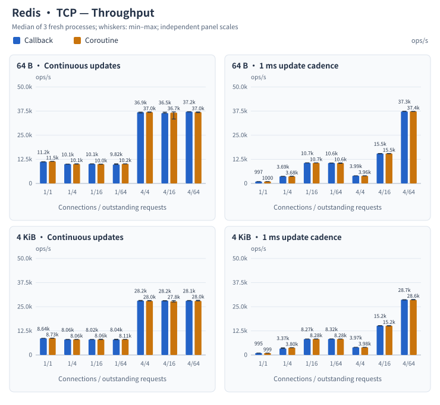
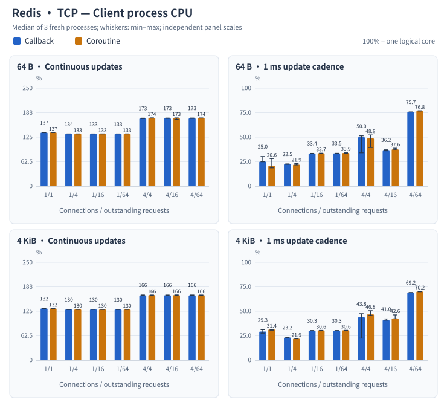
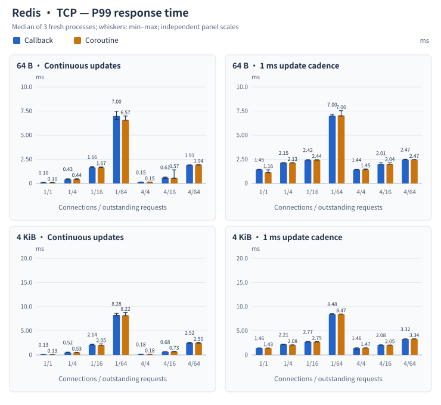
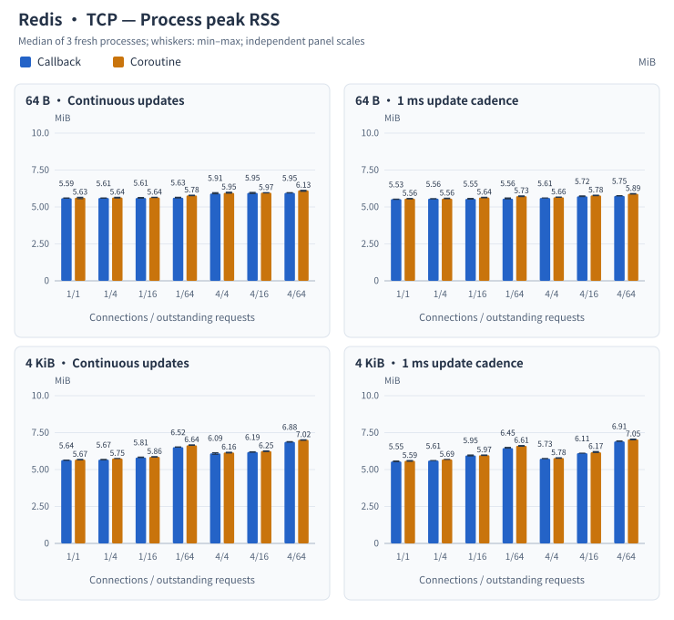
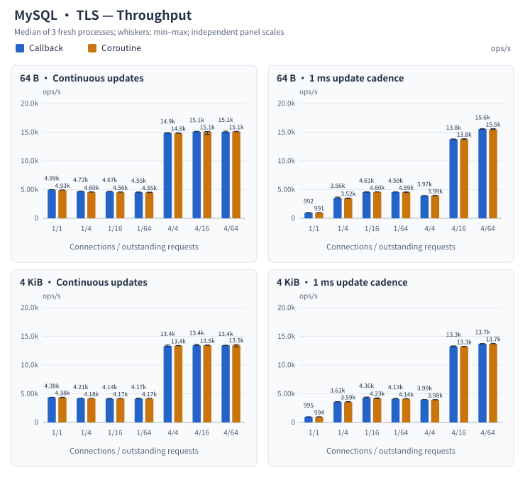
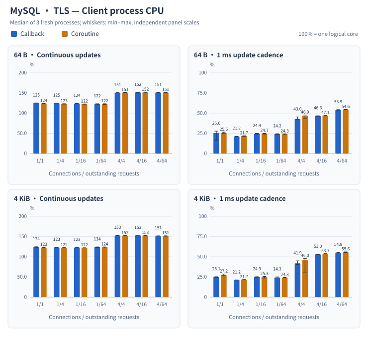
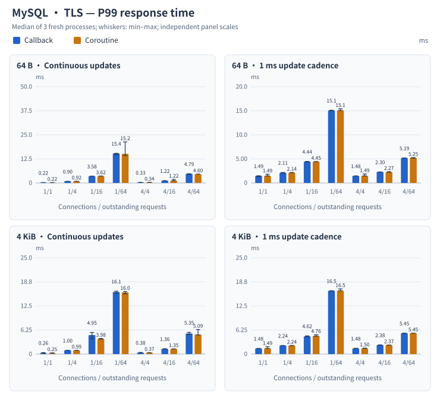
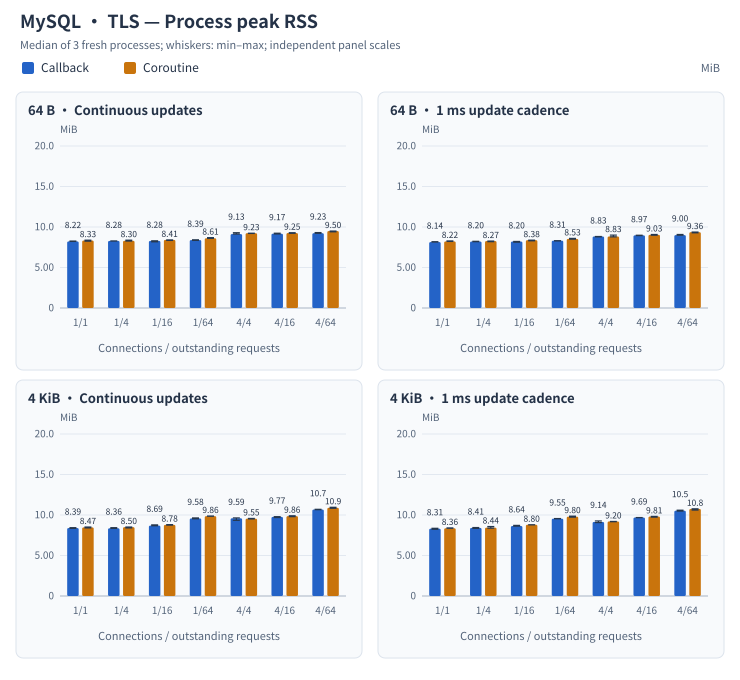

# Database callback and coroutine performance

Matched work through ark's private database services: **56 paired configurations, 336 fresh processes, zero errors**. Each mode completes a fixed operation count three times with Boost.Asio. This measures ark's `database_awaitable`, `manual_runtime` and task-group integration, not an arknet-native coroutine API.

Bars show the median of three runs; short whiskers show min–max. Panel scales are independent. The horizontal axis is **connections / outstanding requests**. Table changes = (coroutine median / callback median − 1) × 100%.

## Redis · TCP

Across all 28 configurations, coroutine throughput medians change by **−1.37% to +12.80%** relative to callbacks; **22/28** three-run ranges overlap. Differences depend on the configuration; no statistical-significance claim is made.

Response time and process memory

P50 and exact values for every metric are in the complete tables below. P99 is each process’s 99th percentile over all requests, followed by the median of three process results; samples are not pooled across processes. RSS is the whole-process high-water mark, including warmup and preallocated latency samples. Callback mode also constructs idle bridge/task objects, so RSS does not isolate coroutine frame costs.

All 28 paired configurations: throughput, CPU, P50, P99 and RSS

### Throughput (ops/s)

| Payload | Owner update | Connections/outstanding | Callback median [range] | Coroutine median [range] | Coroutine change | Ranges overlap |
| --- | --- | --- | ---: | ---: | ---: | --- |
| 64 B | Continuous | 1/1 | 11,246.7 [11,135.8–11,282.4] | 11,452.5 [11,451.4–11,495.0] | +1.83% | No |
| 64 B | Continuous | 1/4 | 10,050.3 [9,980.7–10,052.9] | 10,087.2 [10,026.9–10,185.9] | +0.37% | Yes |
| 64 B | Continuous | 1/16 | 10,140.7 [10,071.8–10,172.5] | 10,018.4 [9,961.2–10,038.5] | −1.21% | No |
| 64 B | Continuous | 1/64 | 9,823.1 [9,820.9–10,186.9] | 10,150.6 [10,110.1–10,177.4] | +3.33% | Yes |
| 64 B | Continuous | 4/4 | 36,926.1 [36,478.0–36,978.4] | 36,975.7 [36,825.5–37,064.4] | +0.13% | Yes |
| 64 B | Continuous | 4/16 | 36,454.9 [36,394.2–36,962.5] | 36,670.6 [33,368.9–37,089.1] | +0.59% | Yes |
| 64 B | Continuous | 4/64 | 37,176.8 [37,073.8–37,204.7] | 36,974.4 [36,690.8–37,059.1] | −0.54% | No |
| 64 B | 1 ms | 1/1 | 996.7 [992.9–997.7] | 999.6 [998.7–999.6] | +0.29% | No |
| 64 B | 1 ms | 1/4 | 3,688.4 [3,608.7–3,708.9] | 3,682.3 [3,659.2–3,773.9] | −0.17% | Yes |
| 64 B | 1 ms | 1/16 | 10,665.1 [10,652.5–10,707.6] | 10,653.9 [10,653.5–10,684.0] | −0.10% | Yes |
| 64 B | 1 ms | 1/64 | 10,622.5 [10,541.9–10,623.1] | 10,603.5 [10,382.1–10,651.7] | −0.18% | Yes |
| 64 B | 1 ms | 4/4 | 3,994.7 [3,970.2–3,994.9] | 3,957.3 [3,928.9–3,998.5] | −0.94% | Yes |
| 64 B | 1 ms | 4/16 | 15,524.6 [15,321.4–15,539.1] | 15,524.4 [15,407.1–15,539.3] | −0.00% | Yes |
| 64 B | 1 ms | 4/64 | 37,282.1 [37,277.3–37,446.7] | 37,362.0 [37,276.6–37,364.2] | +0.21% | Yes |
| 4 KiB | Continuous | 1/1 | 8,638.8 [8,595.2–8,646.6] | 8,727.0 [8,668.5–8,758.3] | +1.02% | No |
| 4 KiB | Continuous | 1/4 | 8,059.4 [7,989.3–8,090.7] | 8,057.2 [8,040.8–8,099.1] | −0.03% | Yes |
| 4 KiB | Continuous | 1/16 | 8,020.9 [7,993.5–8,081.1] | 8,062.0 [7,987.9–8,191.6] | +0.51% | Yes |
| 4 KiB | Continuous | 1/64 | 8,041.8 [7,865.1–8,180.0] | 8,111.6 [8,095.7–8,112.3] | +0.87% | Yes |
| 4 KiB | Continuous | 4/4 | 28,169.4 [27,982.5–28,283.1] | 28,025.2 [28,017.6–28,232.9] | −0.51% | Yes |
| 4 KiB | Continuous | 4/16 | 28,159.9 [27,956.3–28,183.8] | 27,773.2 [27,438.8–28,205.7] | −1.37% | Yes |
| 4 KiB | Continuous | 4/64 | 28,126.6 [28,117.0–28,254.4] | 28,030.1 [28,021.9–28,340.3] | −0.34% | Yes |
| 4 KiB | 1 ms | 1/1 | 994.8 [985.1–997.7] | 998.5 [997.7–999.6] | +0.38% | Yes |
| 4 KiB | 1 ms | 1/4 | 3,367.5 [3,350.1–3,712.4] | 3,798.4 [3,780.8–3,805.5] | +12.80% | No |
| 4 KiB | 1 ms | 1/16 | 8,268.9 [8,265.8–8,299.8] | 8,283.3 [8,251.5–8,316.4] | +0.17% | Yes |
| 4 KiB | 1 ms | 1/64 | 8,319.4 [8,269.6–8,349.9] | 8,282.6 [8,282.5–8,299.8] | −0.44% | Yes |
| 4 KiB | 1 ms | 4/4 | 3,971.5 [3,971.4–3,998.7] | 3,978.1 [3,941.0–3,978.2] | +0.17% | Yes |
| 4 KiB | 1 ms | 4/16 | 15,180.7 [15,053.6–15,251.5] | 15,179.4 [15,025.6–15,206.5] | −0.01% | Yes |
| 4 KiB | 1 ms | 4/64 | 28,673.3 [28,472.2–28,674.9] | 28,572.1 [28,565.2–28,768.8] | −0.35% | Yes |

### Client process CPU (%)

| Payload | Owner update | Connections/outstanding | Callback median [range] | Coroutine median [range] | Coroutine change | Ranges overlap |
| --- | --- | --- | ---: | ---: | ---: | --- |
| 64 B | Continuous | 1/1 | 136.69 [136.63–136.88] | 137.02 [136.83–137.13] | +0.24% | Yes |
| 64 B | Continuous | 1/4 | 133.51 [133.36–133.55] | 133.44 [133.29–133.55] | −0.05% | Yes |
| 64 B | Continuous | 1/16 | 133.36 [133.32–133.47] | 133.49 [133.31–133.58] | +0.09% | Yes |
| 64 B | Continuous | 1/64 | 133.41 [133.40–133.49] | 133.47 [133.45–133.62] | +0.04% | Yes |
| 64 B | Continuous | 4/4 | 173.03 [172.38–173.69] | 173.98 [173.64–174.44] | +0.55% | Yes |
| 64 B | Continuous | 4/16 | 173.00 [172.91–173.92] | 173.30 [170.50–174.34] | +0.18% | Yes |
| 64 B | Continuous | 4/64 | 173.10 [172.90–173.97] | 174.24 [173.58–174.26] | +0.66% | Yes |
| 64 B | 1 ms | 1/1 | 25.03 [24.92–30.35] | 20.62 [18.66–28.22] | −17.64% | Yes |
| 64 B | 1 ms | 1/4 | 22.46 [22.23–22.81] | 21.90 [21.64–23.22] | −2.45% | Yes |
| 64 B | 1 ms | 1/16 | 33.38 [33.29–33.60] | 33.67 [33.62–33.77] | +0.87% | No |
| 64 B | 1 ms | 1/64 | 33.54 [33.48–33.67] | 33.92 [33.68–34.15] | +1.15% | No |
| 64 B | 1 ms | 4/4 | 49.98 [34.11–51.44] | 48.81 [39.43–52.37] | −2.35% | Yes |
| 64 B | 1 ms | 4/16 | 36.23 [36.08–37.20] | 37.59 [37.09–38.81] | +3.76% | Yes |
| 64 B | 1 ms | 4/64 | 75.73 [75.64–75.86] | 76.85 [76.69–77.04] | +1.48% | No |
| 4 KiB | Continuous | 1/1 | 132.16 [132.02–132.25] | 132.24 [132.17–132.32] | +0.06% | Yes |
| 4 KiB | Continuous | 1/4 | 129.72 [129.32–129.81] | 129.65 [129.63–129.84] | −0.06% | Yes |
| 4 KiB | Continuous | 1/16 | 129.64 [129.60–129.76] | 129.54 [129.45–129.81] | −0.08% | Yes |
| 4 KiB | Continuous | 1/64 | 129.59 [129.42–129.71] | 129.67 [129.60–129.71] | +0.06% | Yes |
| 4 KiB | Continuous | 4/4 | 165.68 [165.62–166.73] | 166.33 [166.09–166.66] | +0.39% | Yes |
| 4 KiB | Continuous | 4/16 | 165.73 [165.71–166.65] | 166.18 [166.05–166.88] | +0.27% | Yes |
| 4 KiB | Continuous | 4/64 | 165.66 [165.47–166.70] | 166.16 [165.71–166.65] | +0.30% | Yes |
| 4 KiB | 1 ms | 1/1 | 29.33 [27.66–31.25] | 31.35 [30.69–31.47] | +6.91% | Yes |
| 4 KiB | 1 ms | 1/4 | 23.16 [22.95–23.35] | 21.94 [21.93–22.05] | −5.29% | No |
| 4 KiB | 1 ms | 1/16 | 30.26 [30.25–30.43] | 30.55 [30.50–30.56] | +0.99% | No |
| 4 KiB | 1 ms | 1/64 | 30.31 [30.28–30.43] | 30.64 [30.49–30.64] | +1.09% | No |
| 4 KiB | 1 ms | 4/4 | 43.85 [22.55–47.60] | 46.84 [45.81–50.67] | +6.81% | Yes |
| 4 KiB | 1 ms | 4/16 | 41.01 [40.87–42.25] | 42.62 [42.35–46.34] | +3.92% | No |
| 4 KiB | 1 ms | 4/64 | 69.22 [69.18–69.25] | 70.15 [69.96–70.48] | +1.35% | No |

### P50 response time (ms)

| Payload | Owner update | Connections/outstanding | Callback median [range] | Coroutine median [range] | Coroutine change | Ranges overlap |
| --- | --- | --- | ---: | ---: | ---: | --- |
| 64 B | Continuous | 1/1 | 0.088 [0.088–0.089] | 0.086 [0.086–0.087] | −2.22% | No |
| 64 B | Continuous | 1/4 | 0.397 [0.394–0.400] | 0.392 [0.390–0.398] | −1.19% | Yes |
| 64 B | Continuous | 1/16 | 1.577 [1.573–1.586] | 1.596 [1.589–1.606] | +1.25% | No |
| 64 B | Continuous | 1/64 | 6.520 [6.281–6.537] | 6.298 [6.255–6.328] | −3.41% | Yes |
| 64 B | Continuous | 4/4 | 0.108 [0.107–0.109] | 0.108 [0.107–0.108] | −0.23% | Yes |
| 64 B | Continuous | 4/16 | 0.431 [0.430–0.435] | 0.431 [0.427–0.449] | +0.14% | Yes |
| 64 B | Continuous | 4/64 | 1.719 [1.717–1.722] | 1.724 [1.720–1.737] | +0.29% | Yes |
| 64 B | 1 ms | 1/1 | 0.999 [0.999–0.999] | 1.000 [1.000–1.000] | +0.10% | No |
| 64 B | 1 ms | 1/4 | 1.008 [1.006–1.010] | 1.009 [1.002–1.012] | +0.09% | Yes |
| 64 B | 1 ms | 1/16 | 1.480 [1.479–1.486] | 1.492 [1.490–1.497] | +0.80% | No |
| 64 B | 1 ms | 1/64 | 5.997 [5.996–6.007] | 6.008 [5.997–6.032] | +0.18% | Yes |
| 64 B | 1 ms | 4/4 | 0.989 [0.988–0.993] | 1.000 [1.000–1.000] | +1.13% | No |
| 64 B | 1 ms | 4/16 | 0.996 [0.996–0.996] | 1.001 [1.000–1.001] | +0.46% | No |
| 64 B | 1 ms | 4/64 | 1.872 [1.871–1.874] | 1.878 [1.874–1.882] | +0.28% | Yes |
| 4 KiB | Continuous | 1/1 | 0.115 [0.114–0.115] | 0.114 [0.114–0.115] | −0.62% | Yes |
| 4 KiB | Continuous | 1/4 | 0.495 [0.493–0.496] | 0.494 [0.492–0.495] | −0.21% | Yes |
| 4 KiB | Continuous | 1/16 | 1.994 [1.970–1.998] | 1.981 [1.951–1.991] | −0.66% | Yes |
| 4 KiB | Continuous | 1/64 | 7.951 [7.822–8.138] | 7.878 [7.877–7.884] | −0.92% | Yes |
| 4 KiB | Continuous | 4/4 | 0.141 [0.140–0.142] | 0.142 [0.141–0.142] | +0.59% | Yes |
| 4 KiB | Continuous | 4/16 | 0.566 [0.564–0.571] | 0.572 [0.566–0.578] | +1.11% | Yes |
| 4 KiB | Continuous | 4/64 | 2.268 [2.261–2.275] | 2.275 [2.257–2.279] | +0.29% | Yes |
| 4 KiB | 1 ms | 1/1 | 0.998 [0.998–0.998] | 0.998 [0.998–0.999] | +0.04% | No |
| 4 KiB | 1 ms | 1/4 | 1.082 [0.998–1.190] | 1.001 [1.001–1.001] | −7.52% | Yes |
| 4 KiB | 1 ms | 1/16 | 1.987 [1.984–1.988] | 1.993 [1.984–1.994] | +0.30% | Yes |
| 4 KiB | 1 ms | 1/64 | 7.856 [7.802–7.881] | 7.865 [7.856–7.882] | +0.12% | Yes |
| 4 KiB | 1 ms | 4/4 | 0.991 [0.989–0.995] | 0.999 [0.999–0.999] | +0.79% | No |
| 4 KiB | 1 ms | 4/16 | 0.993 [0.993–0.994] | 1.001 [1.001–1.003] | +0.81% | No |
| 4 KiB | 1 ms | 4/64 | 2.062 [2.054–2.066] | 2.072 [2.065–2.086] | +0.48% | Yes |

### P99 response time (ms)

| Payload | Owner update | Connections/outstanding | Callback median [range] | Coroutine median [range] | Coroutine change | Ranges overlap |
| --- | --- | --- | ---: | ---: | ---: | --- |
| 64 B | Continuous | 1/1 | 0.103 [0.101–0.110] | 0.099 [0.099–0.099] | −3.73% | No |
| 64 B | Continuous | 1/4 | 0.427 [0.423–0.486] | 0.441 [0.424–0.490] | +3.27% | Yes |
| 64 B | Continuous | 1/16 | 1.662 [1.650–1.734] | 1.666 [1.653–1.714] | +0.22% | Yes |
| 64 B | Continuous | 1/64 | 6.995 [6.628–7.491] | 6.572 [6.558–6.987] | −6.05% | Yes |
| 64 B | Continuous | 4/4 | 0.147 [0.145–0.151] | 0.145 [0.145–0.147] | −0.82% | Yes |
| 64 B | Continuous | 4/16 | 0.613 [0.528–0.664] | 0.570 [0.540–1.408] | −6.90% | Yes |
| 64 B | Continuous | 4/64 | 1.908 [1.896–1.927] | 1.944 [1.918–1.955] | +1.88% | Yes |
| 64 B | 1 ms | 1/1 | 1.454 [1.443–1.461] | 1.157 [1.131–1.408] | −20.37% | No |
| 64 B | 1 ms | 1/4 | 2.154 [2.126–2.160] | 2.129 [2.125–2.158] | −1.17% | Yes |
| 64 B | 1 ms | 1/16 | 2.420 [2.418–2.462] | 2.441 [2.415–2.460] | +0.86% | Yes |
| 64 B | 1 ms | 1/64 | 7.004 [7.001–7.175] | 7.063 [6.988–7.539] | +0.84% | Yes |
| 64 B | 1 ms | 4/4 | 1.443 [1.441–1.453] | 1.449 [1.446–1.497] | +0.40% | Yes |
| 64 B | 1 ms | 4/16 | 2.005 [2.001–2.138] | 2.035 [1.996–2.138] | +1.50% | Yes |
| 64 B | 1 ms | 4/64 | 2.470 [2.457–2.504] | 2.473 [2.456–2.473] | +0.11% | Yes |
| 4 KiB | Continuous | 1/1 | 0.130 [0.129–0.134] | 0.128 [0.124–0.129] | −1.54% | No |
| 4 KiB | Continuous | 1/4 | 0.521 [0.520–0.587] | 0.533 [0.520–0.549] | +2.31% | Yes |
| 4 KiB | Continuous | 1/16 | 2.137 [2.129–2.235] | 2.053 [2.038–2.296] | −3.93% | Yes |
| 4 KiB | Continuous | 1/64 | 8.281 [8.188–8.620] | 8.219 [8.120–8.800] | −0.76% | Yes |
| 4 KiB | Continuous | 4/4 | 0.182 [0.182–0.188] | 0.182 [0.182–0.184] | −0.09% | Yes |
| 4 KiB | Continuous | 4/16 | 0.677 [0.676–0.683] | 0.733 [0.658–0.738] | +8.30% | Yes |
| 4 KiB | Continuous | 4/64 | 2.520 [2.464–2.623] | 2.503 [2.447–2.588] | −0.65% | Yes |
| 4 KiB | 1 ms | 1/1 | 1.457 [1.455–1.469] | 1.431 [1.427–1.456] | −1.79% | Yes |
| 4 KiB | 1 ms | 1/4 | 2.214 [2.134–2.229] | 2.084 [2.054–2.103] | −5.86% | No |
| 4 KiB | 1 ms | 1/16 | 2.768 [2.754–2.808] | 2.751 [2.700–2.787] | −0.60% | Yes |
| 4 KiB | 1 ms | 1/64 | 8.478 [8.450–8.553] | 8.474 [8.474–8.483] | −0.05% | Yes |
| 4 KiB | 1 ms | 4/4 | 1.462 [1.033–1.479] | 1.469 [1.467–1.486] | +0.46% | Yes |
| 4 KiB | 1 ms | 4/16 | 2.080 [2.041–2.113] | 2.055 [2.039–2.070] | −1.22% | Yes |
| 4 KiB | 1 ms | 4/64 | 3.325 [3.320–3.343] | 3.336 [3.328–3.350] | +0.33% | Yes |

### Process peak RSS (MiB)

| Payload | Owner update | Connections/outstanding | Callback median [range] | Coroutine median [range] | Coroutine change | Ranges overlap |
| --- | --- | --- | ---: | ---: | ---: | --- |
| 64 B | Continuous | 1/1 | 5.594 [5.594–5.609] | 5.625 [5.563–5.656] | +0.56% | Yes |
| 64 B | Continuous | 1/4 | 5.609 [5.594–5.609] | 5.641 [5.609–5.656] | +0.56% | Yes |
| 64 B | Continuous | 1/16 | 5.609 [5.594–5.641] | 5.641 [5.641–5.656] | +0.56% | Yes |
| 64 B | Continuous | 1/64 | 5.625 [5.609–5.656] | 5.781 [5.766–5.797] | +2.78% | No |
| 64 B | Continuous | 4/4 | 5.906 [5.891–5.969] | 5.953 [5.938–6.000] | +0.79% | Yes |
| 64 B | Continuous | 4/16 | 5.953 [5.906–5.984] | 5.969 [5.953–5.969] | +0.26% | Yes |
| 64 B | Continuous | 4/64 | 5.953 [5.953–5.969] | 6.125 [6.063–6.125] | +2.89% | No |
| 64 B | 1 ms | 1/1 | 5.531 [5.516–5.531] | 5.563 [5.547–5.578] | +0.56% | No |
| 64 B | 1 ms | 1/4 | 5.563 [5.547–5.563] | 5.563 [5.563–5.594] | +0.00% | Yes |
| 64 B | 1 ms | 1/16 | 5.547 [5.531–5.578] | 5.641 [5.625–5.656] | +1.69% | No |
| 64 B | 1 ms | 1/64 | 5.563 [5.547–5.609] | 5.734 [5.703–5.750] | +3.09% | No |
| 64 B | 1 ms | 4/4 | 5.609 [5.609–5.609] | 5.656 [5.656–5.672] | +0.84% | No |
| 64 B | 1 ms | 4/16 | 5.719 [5.703–5.750] | 5.781 [5.766–5.797] | +1.09% | No |
| 64 B | 1 ms | 4/64 | 5.750 [5.750–5.766] | 5.891 [5.875–5.906] | +2.45% | No |
| 4 KiB | Continuous | 1/1 | 5.641 [5.625–5.641] | 5.672 [5.656–5.688] | +0.55% | No |
| 4 KiB | Continuous | 1/4 | 5.672 [5.656–5.688] | 5.750 [5.750–5.750] | +1.38% | No |
| 4 KiB | Continuous | 1/16 | 5.813 [5.813–5.844] | 5.859 [5.844–5.875] | +0.81% | Yes |
| 4 KiB | Continuous | 1/64 | 6.516 [6.516–6.531] | 6.641 [6.641–6.672] | +1.92% | No |
| 4 KiB | Continuous | 4/4 | 6.094 [6.031–6.141] | 6.156 [6.125–6.172] | +1.03% | Yes |
| 4 KiB | Continuous | 4/16 | 6.188 [6.172–6.203] | 6.250 [6.219–6.266] | +1.01% | No |
| 4 KiB | Continuous | 4/64 | 6.875 [6.859–6.891] | 7.016 [6.984–7.016] | +2.05% | No |
| 4 KiB | 1 ms | 1/1 | 5.547 [5.531–5.578] | 5.594 [5.563–5.609] | +0.85% | Yes |
| 4 KiB | 1 ms | 1/4 | 5.609 [5.609–5.609] | 5.688 [5.688–5.688] | +1.39% | No |
| 4 KiB | 1 ms | 1/16 | 5.953 [5.922–5.984] | 5.969 [5.953–5.984] | +0.26% | Yes |
| 4 KiB | 1 ms | 1/64 | 6.453 [6.453–6.500] | 6.609 [6.578–6.625] | +2.42% | No |
| 4 KiB | 1 ms | 4/4 | 5.734 [5.734–5.750] | 5.781 [5.766–5.797] | +0.82% | No |
| 4 KiB | 1 ms | 4/16 | 6.109 [6.109–6.109] | 6.172 [6.156–6.219] | +1.02% | No |
| 4 KiB | 1 ms | 4/64 | 6.906 [6.906–6.938] | 7.047 [7.016–7.063] | +2.04% | No |

## MySQL · TLS

Across all 28 configurations, coroutine throughput medians change by **−3.01% to +0.81%** relative to callbacks; **24/28** three-run ranges overlap. Differences depend on the configuration; no statistical-significance claim is made.

Response time and process memory

P50 and exact values for every metric are in the complete tables below. P99 is each process’s 99th percentile over all requests, followed by the median of three process results; samples are not pooled across processes. RSS is the whole-process high-water mark, including warmup and preallocated latency samples. Callback mode also constructs idle bridge/task objects, so RSS does not isolate coroutine frame costs.

All 28 paired configurations: throughput, CPU, P50, P99 and RSS

### Throughput (ops/s)

| Payload | Owner update | Connections/outstanding | Callback median [range] | Coroutine median [range] | Coroutine change | Ranges overlap |
| --- | --- | --- | ---: | ---: | ---: | --- |
| 64 B | Continuous | 1/1 | 4,994.9 [4,973.6–5,006.5] | 4,933.1 [4,923.3–4,945.5] | −1.24% | No |
| 64 B | Continuous | 1/4 | 4,720.8 [4,720.7–4,731.6] | 4,601.0 [4,564.7–4,609.8] | −2.54% | No |
| 64 B | Continuous | 1/16 | 4,665.5 [4,663.5–4,708.9] | 4,555.6 [4,555.6–4,595.7] | −2.36% | No |
| 64 B | Continuous | 1/64 | 4,552.4 [4,538.2–4,590.4] | 4,550.3 [4,485.9–4,557.3] | −0.04% | Yes |
| 64 B | Continuous | 4/4 | 14,894.2 [14,845.6–14,913.4] | 14,833.0 [14,804.0–14,877.7] | −0.41% | Yes |
| 64 B | Continuous | 4/16 | 15,124.9 [15,071.7–15,140.7] | 15,118.2 [14,588.3–15,124.7] | −0.04% | Yes |
| 64 B | Continuous | 4/64 | 15,067.2 [14,991.9–15,193.1] | 15,127.0 [15,095.0–15,139.3] | +0.40% | Yes |
| 64 B | 1 ms | 1/1 | 991.9 [979.5–999.7] | 991.0 [986.2–996.7] | −0.10% | Yes |
| 64 B | 1 ms | 1/4 | 3,564.0 [3,511.9–3,698.4] | 3,517.3 [3,434.8–3,530.0] | −1.31% | Yes |
| 64 B | 1 ms | 1/16 | 4,610.1 [4,528.9–4,610.7] | 4,599.6 [4,594.7–4,602.0] | −0.23% | Yes |
| 64 B | 1 ms | 1/64 | 4,594.4 [4,584.8–4,600.2] | 4,589.9 [4,508.3–4,594.8] | −0.10% | Yes |
| 64 B | 1 ms | 4/4 | 3,971.5 [3,967.3–3,975.4] | 3,986.9 [3,940.9–3,988.1] | +0.39% | Yes |
| 64 B | 1 ms | 4/16 | 13,798.9 [13,727.5–13,821.7] | 13,832.0 [13,750.5–13,860.8] | +0.24% | Yes |
| 64 B | 1 ms | 4/64 | 15,566.6 [15,522.0–15,613.4] | 15,499.1 [15,478.4–15,611.8] | −0.43% | Yes |
| 4 KiB | Continuous | 1/1 | 4,378.3 [4,325.6–4,387.1] | 4,379.2 [4,316.8–4,391.7] | +0.02% | Yes |
| 4 KiB | Continuous | 1/4 | 4,212.4 [4,198.4–4,214.1] | 4,183.9 [4,181.8–4,185.2] | −0.68% | No |
| 4 KiB | Continuous | 1/16 | 4,140.9 [4,114.9–4,190.4] | 4,174.5 [4,170.5–4,181.2] | +0.81% | Yes |
| 4 KiB | Continuous | 1/64 | 4,168.6 [4,151.7–4,217.9] | 4,171.5 [4,163.9–4,182.4] | +0.07% | Yes |
| 4 KiB | Continuous | 4/4 | 13,350.5 [13,131.8–13,479.5] | 13,403.4 [13,394.9–13,404.3] | +0.40% | Yes |
| 4 KiB | Continuous | 4/16 | 13,435.9 [13,407.3–13,627.2] | 13,463.4 [13,439.6–13,485.2] | +0.20% | Yes |
| 4 KiB | Continuous | 4/64 | 13,447.9 [13,388.2–13,455.6] | 13,488.1 [13,153.8–13,569.0] | +0.30% | Yes |
| 4 KiB | 1 ms | 1/1 | 994.8 [994.8–995.9] | 993.9 [989.0–994.9] | −0.09% | Yes |
| 4 KiB | 1 ms | 1/4 | 3,614.4 [3,550.8–3,630.1] | 3,585.1 [3,563.8–3,639.8] | −0.81% | Yes |
| 4 KiB | 1 ms | 1/16 | 4,360.5 [4,251.8–4,432.6] | 4,229.2 [4,152.5–4,278.1] | −3.01% | Yes |
| 4 KiB | 1 ms | 1/64 | 4,131.3 [4,126.4–4,182.6] | 4,135.8 [4,133.0–4,144.4] | +0.11% | Yes |
| 4 KiB | 1 ms | 4/4 | 3,988.1 [3,967.9–3,999.7] | 3,979.6 [3,959.2–3,990.9] | −0.21% | Yes |
| 4 KiB | 1 ms | 4/16 | 13,282.9 [13,220.8–13,336.3] | 13,250.1 [13,210.9–13,261.1] | −0.25% | Yes |
| 4 KiB | 1 ms | 4/64 | 13,717.2 [13,669.3–13,750.5] | 13,716.9 [13,716.2–13,773.8] | −0.00% | Yes |

### Client process CPU (%)

| Payload | Owner update | Connections/outstanding | Callback median [range] | Coroutine median [range] | Coroutine change | Ranges overlap |
| --- | --- | --- | ---: | ---: | ---: | --- |
| 64 B | Continuous | 1/1 | 125.29 [124.89–125.30] | 124.06 [123.67–124.34] | −0.98% | No |
| 64 B | Continuous | 1/4 | 124.85 [124.81–125.02] | 122.95 [122.48–123.39] | −1.53% | No |
| 64 B | Continuous | 1/16 | 123.91 [123.79–124.51] | 122.34 [122.15–122.80] | −1.26% | No |
| 64 B | Continuous | 1/64 | 122.25 [122.03–123.30] | 122.21 [121.47–123.36] | −0.04% | Yes |
| 64 B | Continuous | 4/4 | 150.86 [150.83–150.93] | 151.14 [150.91–151.42] | +0.18% | Yes |
| 64 B | Continuous | 4/16 | 151.53 [151.27–151.69] | 151.64 [151.60–152.16] | +0.07% | Yes |
| 64 B | Continuous | 4/64 | 151.17 [151.09–151.21] | 151.41 [151.20–151.47] | +0.15% | Yes |
| 64 B | 1 ms | 1/1 | 25.59 [16.56–27.78] | 25.56 [25.18–26.51] | −0.11% | Yes |
| 64 B | 1 ms | 1/4 | 21.23 [21.01–21.36] | 21.74 [21.21–21.99] | +2.39% | Yes |
| 64 B | 1 ms | 1/16 | 24.43 [24.14–24.95] | 24.73 [24.16–25.07] | +1.24% | Yes |
| 64 B | 1 ms | 1/64 | 24.17 [23.84–24.48] | 24.30 [23.18–24.36] | +0.55% | Yes |
| 64 B | 1 ms | 4/4 | 42.95 [42.48–45.34] | 46.92 [43.18–47.74] | +9.24% | Yes |
| 64 B | 1 ms | 4/16 | 46.62 [46.25–46.73] | 47.05 [47.02–47.09] | +0.94% | No |
| 64 B | 1 ms | 4/64 | 53.89 [53.64–54.32] | 54.61 [54.52–54.64] | +1.33% | No |
| 4 KiB | Continuous | 1/1 | 123.99 [123.50–124.76] | 122.58 [122.54–123.63] | −1.14% | Yes |
| 4 KiB | Continuous | 1/4 | 123.16 [122.86–123.54] | 122.23 [122.04–122.62] | −0.76% | No |
| 4 KiB | Continuous | 1/16 | 122.82 [122.71–123.12] | 121.95 [121.76–122.26] | −0.71% | No |
| 4 KiB | Continuous | 1/64 | 124.23 [122.94–124.29] | 124.02 [121.71–124.28] | −0.17% | Yes |
| 4 KiB | Continuous | 4/4 | 152.62 [152.56–153.20] | 152.14 [151.88–152.31] | −0.31% | No |
| 4 KiB | Continuous | 4/16 | 152.93 [152.89–152.96] | 152.71 [152.28–152.76] | −0.14% | No |
| 4 KiB | Continuous | 4/64 | 151.33 [151.28–151.76] | 151.49 [150.94–151.83] | +0.11% | Yes |
| 4 KiB | 1 ms | 1/1 | 25.12 [24.23–25.24] | 27.20 [26.49–28.60] | +8.27% | No |
| 4 KiB | 1 ms | 1/4 | 21.24 [21.17–21.33] | 21.70 [21.66–21.74] | +2.18% | No |
| 4 KiB | 1 ms | 1/16 | 24.89 [24.57–25.22] | 25.28 [23.68–25.55] | +1.58% | Yes |
| 4 KiB | 1 ms | 1/64 | 24.30 [23.91–25.06] | 24.30 [24.18–24.36] | −0.00% | Yes |
| 4 KiB | 1 ms | 4/4 | 41.86 [40.43–44.90] | 46.02 [30.98–47.95] | +9.94% | Yes |
| 4 KiB | 1 ms | 4/16 | 52.96 [52.46–53.11] | 53.70 [53.46–53.89] | +1.40% | No |
| 4 KiB | 1 ms | 4/64 | 54.93 [54.80–55.47] | 55.57 [55.37–56.03] | +1.16% | Yes |

### P50 response time (ms)

| Payload | Owner update | Connections/outstanding | Callback median [range] | Coroutine median [range] | Coroutine change | Ranges overlap |
| --- | --- | --- | ---: | ---: | ---: | --- |
| 64 B | Continuous | 1/1 | 0.198 [0.197–0.198] | 0.203 [0.202–0.203] | +2.62% | No |
| 64 B | Continuous | 1/4 | 0.845 [0.844–0.845] | 0.870 [0.869–0.879] | +3.00% | No |
| 64 B | Continuous | 1/16 | 3.428 [3.393–3.429] | 3.522 [3.489–3.526] | +2.75% | No |
| 64 B | Continuous | 1/64 | 14.066 [13.923–14.085] | 14.078 [14.072–14.089] | +0.08% | Yes |
| 64 B | Continuous | 4/4 | 0.267 [0.267–0.268] | 0.268 [0.267–0.269] | +0.14% | Yes |
| 64 B | Continuous | 4/16 | 1.056 [1.056–1.061] | 1.058 [1.058–1.071] | +0.11% | Yes |
| 64 B | Continuous | 4/64 | 4.238 [4.206–4.257] | 4.226 [4.226–4.238] | −0.29% | Yes |
| 64 B | 1 ms | 1/1 | 0.999 [0.999–1.000] | 1.000 [1.000–1.000] | +0.04% | No |
| 64 B | 1 ms | 1/4 | 1.000 [0.999–1.001] | 1.003 [1.002–1.012] | +0.28% | No |
| 64 B | 1 ms | 1/16 | 3.416 [3.405–3.528] | 3.434 [3.427–3.440] | +0.54% | Yes |
| 64 B | 1 ms | 1/64 | 13.981 [13.966–13.982] | 13.984 [13.978–14.082] | +0.02% | Yes |
| 64 B | 1 ms | 4/4 | 0.994 [0.994–0.995] | 1.000 [0.999–1.000] | +0.54% | No |
| 64 B | 1 ms | 4/16 | 1.027 [1.025–1.031] | 1.029 [1.026–1.031] | +0.26% | Yes |
| 64 B | 1 ms | 4/64 | 4.014 [4.012–4.023] | 4.025 [4.019–4.026] | +0.27% | Yes |
| 4 KiB | Continuous | 1/1 | 0.226 [0.226–0.227] | 0.228 [0.227–0.228] | +0.57% | Yes |
| 4 KiB | Continuous | 1/4 | 0.949 [0.948–0.952] | 0.955 [0.954–0.956] | +0.69% | No |
| 4 KiB | Continuous | 1/16 | 3.826 [3.818–3.831] | 3.829 [3.825–3.829] | +0.07% | Yes |
| 4 KiB | Continuous | 1/64 | 15.360 [15.324–15.380] | 15.364 [15.338–15.394] | +0.03% | Yes |
| 4 KiB | Continuous | 4/4 | 0.298 [0.295–0.298] | 0.297 [0.297–0.297] | −0.18% | Yes |
| 4 KiB | Continuous | 4/16 | 1.186 [1.169–1.191] | 1.185 [1.183–1.188] | −0.12% | Yes |
| 4 KiB | Continuous | 4/64 | 4.745 [4.727–4.774] | 4.737 [4.713–4.783] | −0.19% | Yes |
| 4 KiB | 1 ms | 1/1 | 0.998 [0.998–0.998] | 0.999 [0.999–0.999] | +0.03% | No |
| 4 KiB | 1 ms | 1/4 | 0.998 [0.998–0.999] | 1.001 [1.000–1.001] | +0.28% | No |
| 4 KiB | 1 ms | 1/16 | 3.822 [3.717–3.890] | 3.912 [3.872–3.940] | +2.38% | Yes |
| 4 KiB | 1 ms | 1/64 | 15.461 [15.167–15.465] | 15.341 [15.333–15.449] | −0.78% | Yes |
| 4 KiB | 1 ms | 4/4 | 0.994 [0.992–0.994] | 0.999 [0.998–1.000] | +0.52% | No |
| 4 KiB | 1 ms | 4/16 | 1.036 [1.034–1.041] | 1.057 [1.047–1.059] | +1.96% | No |
| 4 KiB | 1 ms | 4/64 | 4.837 [4.824–4.846] | 4.819 [4.815–4.858] | −0.37% | Yes |

### P99 response time (ms)

| Payload | Owner update | Connections/outstanding | Callback median [range] | Coroutine median [range] | Coroutine change | Ranges overlap |
| --- | --- | --- | ---: | ---: | ---: | --- |
| 64 B | Continuous | 1/1 | 0.221 [0.221–0.227] | 0.222 [0.221–0.223] | +0.66% | Yes |
| 64 B | Continuous | 1/4 | 0.904 [0.898–0.907] | 0.921 [0.915–0.924] | +1.82% | No |
| 64 B | Continuous | 1/16 | 3.580 [3.575–3.581] | 3.619 [3.616–3.634] | +1.07% | No |
| 64 B | Continuous | 1/64 | 15.392 [14.781–15.411] | 15.160 [14.264–21.343] | −1.51% | Yes |
| 64 B | Continuous | 4/4 | 0.328 [0.322–0.332] | 0.338 [0.335–0.350] | +3.06% | No |
| 64 B | Continuous | 4/16 | 1.217 [1.190–1.224] | 1.224 [1.193–1.879] | +0.59% | Yes |
| 64 B | Continuous | 4/64 | 4.789 [4.613–4.814] | 4.598 [4.593–4.619] | −3.98% | Yes |
| 64 B | 1 ms | 1/1 | 1.492 [1.292–1.499] | 1.490 [1.474–1.824] | −0.11% | Yes |
| 64 B | 1 ms | 1/4 | 2.112 [2.104–2.185] | 2.143 [2.126–2.181] | +1.50% | Yes |
| 64 B | 1 ms | 1/16 | 4.441 [4.418–4.487] | 4.453 [4.439–4.457] | +0.27% | Yes |
| 64 B | 1 ms | 1/64 | 15.087 [15.042–15.120] | 15.090 [15.067–15.430] | +0.02% | Yes |
| 64 B | 1 ms | 4/4 | 1.484 [1.482–1.485] | 1.490 [1.481–1.872] | +0.42% | Yes |
| 64 B | 1 ms | 4/16 | 2.304 [2.288–2.307] | 2.273 [2.251–2.341] | −1.34% | Yes |
| 64 B | 1 ms | 4/64 | 5.194 [5.178–5.209] | 5.246 [5.184–5.277] | +1.01% | Yes |
| 4 KiB | Continuous | 1/1 | 0.255 [0.254–0.381] | 0.248 [0.248–0.319] | −2.74% | Yes |
| 4 KiB | Continuous | 1/4 | 0.996 [0.993–0.999] | 0.993 [0.990–0.993] | −0.38% | No |
| 4 KiB | Continuous | 1/16 | 4.954 [3.970–5.626] | 3.976 [3.904–4.056] | −19.75% | Yes |
| 4 KiB | Continuous | 1/64 | 16.141 [15.818–16.351] | 16.032 [15.657–16.246] | −0.67% | Yes |
| 4 KiB | Continuous | 4/4 | 0.379 [0.376–0.436] | 0.374 [0.365–0.377] | −1.18% | Yes |
| 4 KiB | Continuous | 4/16 | 1.359 [1.336–1.394] | 1.354 [1.354–1.362] | −0.37% | Yes |
| 4 KiB | Continuous | 4/64 | 5.347 [5.131–5.650] | 5.086 [4.981–6.385] | −4.87% | Yes |
| 4 KiB | 1 ms | 1/1 | 1.482 [1.481–1.485] | 1.486 [1.483–1.923] | +0.25% | Yes |
| 4 KiB | 1 ms | 1/4 | 2.240 [2.237–2.240] | 2.238 [2.234–2.244] | −0.09% | Yes |
| 4 KiB | 1 ms | 1/16 | 4.620 [4.514–4.743] | 4.759 [4.683–5.035] | +3.01% | Yes |
| 4 KiB | 1 ms | 1/64 | 16.466 [16.418–16.468] | 16.476 [16.457–16.951] | +0.06% | Yes |
| 4 KiB | 1 ms | 4/4 | 1.482 [1.479–1.513] | 1.498 [1.489–1.557] | +1.13% | Yes |
| 4 KiB | 1 ms | 4/16 | 2.382 [2.350–2.401] | 2.368 [2.363–2.371] | −0.57% | Yes |
| 4 KiB | 1 ms | 4/64 | 5.449 [5.436–5.449] | 5.451 [5.448–5.452] | +0.04% | Yes |

### Process peak RSS (MiB)

| Payload | Owner update | Connections/outstanding | Callback median [range] | Coroutine median [range] | Coroutine change | Ranges overlap |
| --- | --- | --- | ---: | ---: | ---: | --- |
| 64 B | Continuous | 1/1 | 8.219 [8.219–8.266] | 8.328 [8.250–8.375] | +1.33% | Yes |
| 64 B | Continuous | 1/4 | 8.281 [8.266–8.281] | 8.297 [8.266–8.375] | +0.19% | Yes |
| 64 B | Continuous | 1/16 | 8.281 [8.172–8.297] | 8.406 [8.344–8.406] | +1.51% | No |
| 64 B | Continuous | 1/64 | 8.391 [8.344–8.422] | 8.609 [8.594–8.688] | +2.61% | No |
| 64 B | Continuous | 4/4 | 9.125 [9.125–9.297] | 9.234 [9.203–9.234] | +1.20% | Yes |
| 64 B | Continuous | 4/16 | 9.172 [9.141–9.234] | 9.250 [9.219–9.297] | +0.85% | Yes |
| 64 B | Continuous | 4/64 | 9.234 [9.219–9.313] | 9.500 [9.406–9.500] | +2.88% | No |
| 64 B | 1 ms | 1/1 | 8.141 [8.141–8.188] | 8.219 [8.219–8.281] | +0.96% | No |
| 64 B | 1 ms | 1/4 | 8.203 [8.188–8.234] | 8.266 [8.188–8.266] | +0.76% | Yes |
| 64 B | 1 ms | 1/16 | 8.203 [8.125–8.219] | 8.375 [8.297–8.375] | +2.10% | No |
| 64 B | 1 ms | 1/64 | 8.313 [8.281–8.313] | 8.531 [8.500–8.594] | +2.63% | No |
| 64 B | 1 ms | 4/4 | 8.828 [8.781–8.828] | 8.828 [8.781–9.000] | +0.00% | Yes |
| 64 B | 1 ms | 4/16 | 8.969 [8.938–8.984] | 9.031 [8.984–9.078] | +0.70% | Yes |
| 64 B | 1 ms | 4/64 | 9.000 [8.984–9.078] | 9.359 [9.281–9.375] | +3.99% | No |
| 4 KiB | Continuous | 1/1 | 8.391 [8.344–8.438] | 8.469 [8.406–8.516] | +0.93% | Yes |
| 4 KiB | Continuous | 1/4 | 8.359 [8.344–8.438] | 8.500 [8.406–8.516] | +1.68% | Yes |
| 4 KiB | Continuous | 1/16 | 8.688 [8.672–8.781] | 8.781 [8.750–8.813] | +1.08% | Yes |
| 4 KiB | Continuous | 1/64 | 9.578 [9.531–9.641] | 9.859 [9.844–9.875] | +2.94% | No |
| 4 KiB | Continuous | 4/4 | 9.594 [9.344–9.641] | 9.547 [9.516–9.578] | −0.49% | Yes |
| 4 KiB | Continuous | 4/16 | 9.766 [9.688–9.797] | 9.859 [9.797–9.906] | +0.96% | Yes |
| 4 KiB | Continuous | 4/64 | 10.672 [10.656–10.703] | 10.891 [10.828–10.953] | +2.05% | No |
| 4 KiB | 1 ms | 1/1 | 8.313 [8.234–8.359] | 8.359 [8.359–8.406] | +0.56% | Yes |
| 4 KiB | 1 ms | 1/4 | 8.406 [8.344–8.453] | 8.438 [8.375–8.578] | +0.37% | Yes |
| 4 KiB | 1 ms | 1/16 | 8.641 [8.625–8.719] | 8.797 [8.781–8.797] | +1.81% | No |
| 4 KiB | 1 ms | 1/64 | 9.547 [9.531–9.563] | 9.797 [9.734–9.859] | +2.62% | No |
| 4 KiB | 1 ms | 4/4 | 9.141 [9.063–9.266] | 9.203 [9.172–9.203] | +0.68% | Yes |
| 4 KiB | 1 ms | 4/16 | 9.688 [9.672–9.688] | 9.813 [9.734–9.828] | +1.29% | No |
| 4 KiB | 1 ms | 4/64 | 10.531 [10.484–10.594] | 10.750 [10.609–10.766] | +2.08% | No |

## Measurement scope

| Item | Configuration |
| --- | --- |
| Machine | Mac mini Mac16,11 · Apple M4 Pro · 14 cores (10 performance + 4 efficiency) · 48 GiB |
| OS / compiler | macOS 27.0.1 (26A434) · LLVM 22.1.7 · Release, no sanitizers |
| Dependencies / services | Boost 1.90.0 · OpenSSL 3.6.4 · MySQL Community 8.4.11 · Redis 7.4.2 |
| Execution | One owner thread + one IO context/worker shared by the pool; 1/4 connections do not change the worker count; local IPv4 loopback |
| Work | One binary Redis ECHO or one MySQL text SELECT with verified TLS; 64 B / 4 KiB |
| Updates / repeats | Continuous polling or 1 ms cadence; alternating callback/coroutine order; 3 fresh processes per mode/cell |
| Counts | 5,044,224 measured and 768,000 warmup operations; fixed counts, not fixed duration |
| CPU | Complete client process; 100% = one logical core; database process excluded |
| Response time | Owner submission to owner delivery, including pool lease/reset wait, IO, database and owner cadence |
| UTC interval | 2026-10-15T20:22:07Z to 2026-10-15T20:31:57Z |
| Source | ark `ab6f82f320a472869a06e155c2c73c3d7728354b`; arknet `2aa5bc0ef7d383d8cfbc04520f3b952fa27c5fbd` |

Individual measured intervals are 0.383–3.046 seconds, with 80/336 intervals shorter than one second; these results alone do not determine an API choice. Connection/runtime construction and warmup are excluded. Owning validation, refill and coroutine task/bridge work are included in wall time/CPU. Cadence does not catch up missed ticks. Each request returns its lease and follows native pool reset policy; this is not a native client peak-throughput or protocol-pipeline test with a permanently held connection.

Fixed operation counts and raw evidence

| Update cadence | Connections/outstanding | Measured per process | Warmup per process |
| --- | --- | ---: | ---: |
| Continuous | 1/1 | 10,000 | 1,000 |
| Continuous | 1/4 | 10,000 | 1,000 |
| Continuous | 1/16 | 10,000 | 1,000 |
| Continuous | 1/64 | 10,000 | 1,000 |
| Continuous | 4/4 | 40,000 | 4,000 |
| Continuous | 4/16 | 40,000 | 4,000 |
| Continuous | 4/64 | 40,000 | 4,000 |
| 1 ms | 1/1 | 1,024 | 1,000 |
| 1 ms | 1/4 | 4,096 | 1,000 |
| 1 ms | 1/16 | 4,096 | 1,000 |
| 1 ms | 1/64 | 4,096 | 1,000 |
| 1 ms | 4/4 | 4,096 | 4,000 |
| 1 ms | 4/16 | 16,384 | 4,000 |
| 1 ms | 4/64 | 16,384 | 4,000 |

Raw records and source/binary/dependency hashes remain in the independent local measurement directory, outside the source repository, with no published download. The generator checks all 336 process outputs, exit codes and stderr, then computes all 56 paired medians/ranges/changes. [Formal C++ benchmark usage](https://github.com/OpenArkStudio/ark/blob/ab6f82f320a472869a06e155c2c73c3d7728354b/benchmarks/DATABASE.md) provides build/run instructions and metric definitions.

- The hash lock covers only its 2,436 recorded inputs; MySQL `@loader_path` relative dynamic libraries are not a complete transitive dependency hash closure.
- The recorded `ninja -n` output proposes CMake regeneration; no rebuild was executed and pre-measurement hashes were not reconstructed afterward. These limits do not demonstrate a dependency change.

These closed-loop, local short-duration results do not establish saturation capacity, cross-host behavior, production-duration endurance or cluster PCU.
