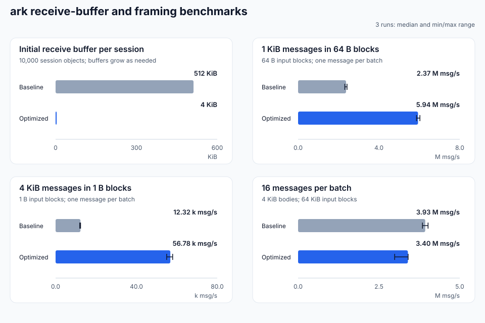

# Receive-buffer and framing performance

48 measurements were run locally on 2026-10-15 using Release builds and the standalone C++ program. All configurations are retained.

## Environment

| Item | Configuration |
| --- | --- |
| Machine | Mac mini Mac16,11, Apple M4 Pro, 14 cores, 48 GiB |
| OS | macOS 27.0.1 (26A434), arm64 |
| Compiler | Apple clang version 21.0.0 (clang-2100.3.34.2) |
| Build | Release (-O3 -DNDEBUG -fPIC), C++20, Boost 1.90.0 |
| Repetitions and warmup | 3 runs; 10,000 warmup batches per framing run |

## Results

Initial receive-buffer requests for 10,000 session objects: **5,000 MiB → 39.1 MiB (99.22% less)**. This counts application buffer arrays; socket buffers, queues and other objects are separate.

| Body / B | Input block / B | Batch | Baseline / msg/s | Optimized / msg/s | Change | Baseline CPU / % | Optimized CPU / % |
| ---: | ---: | ---: | ---: | ---: | ---: | ---: | ---: |
| 64 | 65536 | 1 | 18,452,200 | 18,169,900 | -1.5% | 100.0 | 100.0 |
| 1024 | 65536 | 1 | 10,594,000 | 10,716,400 | +1.2% | 100.0 | 100.0 |
| 4096 | 65536 | 1 | 4,484,430 | 4,889,330 | +9.0% | 100.0 | 100.0 |
| 1024 | 64 | 1 | 2,469,930 | 5,992,910 | +142.6% | 100.0 | 100.0 |
| 4096 | 1 | 1 | 12,887 | 58,470 | +353.7% | 100.0 | 100.0 |
| 1024 | 64 | 16 | 2,647,390 | 5,708,850 | +115.6% | 100.0 | 100.0 |
| 4096 | 65536 | 16 | 3,954,890 | 3,366,490 | -14.9% | 100.0 | 100.0 |

- 1 KiB / 64 B blocks: ordinary object allocations per message **18 → 2**.
- 4 KiB / bytewise input: ordinary object allocations per message **4098 → 2**.
- 4 KiB / 64 KiB blocks / batch 16: throughput changed **-14.9%**; the memory/throughput tradeoff is retained.

CPU 100% represents one logical core. This single-threaded program includes message validation in its timing. Connection capacity, network throughput and RTT require end-to-end acceptance.

## Reproduction and raw records

- [Build and run options](../../benchmarks/README.md)
- [Baseline data](../../benchmarks/results/macmini-m4pro-20261015/receive-buffers/before.jsonl) · [Optimized data](../../benchmarks/results/macmini-m4pro-20261015/receive-buffers/after.jsonl)
- [Machine, source and binary hashes](../../benchmarks/results/macmini-m4pro-20261015/receive-buffers/metadata.json)
- [Baseline commit](https://github.com/OpenArkStudio/ARK/commit/104c138b361265f56255a8ff4bb533a5870ad0ee)

Both implementations use the same benchmark source. Baseline and optimized rounds alternate three times, with a fresh process per case and no concurrent compilation.
