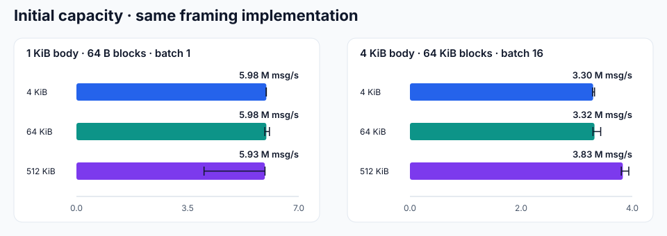

# Receive-buffer and framing performance

66 measurements were run locally on 2026-10-15 using Release builds and the standalone C++ program. All configurations are retained.

## Environment

| Item | Configuration |
| --- | --- |
| Machine | Mac mini Mac16,11, Apple M4 Pro, 14 cores, 48 GiB |
| OS | macOS 27.0.1 (26A434), arm64 |
| Compiler | Apple clang version 21.0.0 (clang-2100.3.34.2) |
| Build | Release (-O3 -DNDEBUG -std=gnu++20 -fPIC), C++20, Boost 1.90.0; arknet 848588e409bf7e5f86bc30b8ffae7efb022eb6e4 |
| Repetitions and warmup | 3 runs; 10,000 warmup batches per framing run |

## Results

Initial receive-buffer requests for 10,000 session objects: **5,000 MiB → 39.1 MiB (99.22% less)**. This counts application buffer arrays; socket buffers, queues and other objects are separate.

| Body / B | Input block / B | Batch | Baseline / msg/s | Optimized / msg/s | Change | Baseline CPU / % | Optimized CPU / % |
| ---: | ---: | ---: | ---: | ---: | ---: | ---: | ---: |
| 64 | 65536 | 1 | 17,519,100 | 18,455,000 | +5.3% | 100.0 | 100.0 |
| 1024 | 65536 | 1 | 10,460,500 | 10,490,300 | +0.3% | 99.9 | 100.0 |
| 4096 | 65536 | 1 | 4,476,530 | 4,828,650 | +7.9% | 100.0 | 100.0 |
| 1024 | 64 | 1 | 2,374,330 | 5,935,260 | +150.0% | 100.0 | 100.0 |
| 4096 | 1 | 1 | 12,316 | 56,783 | +361.0% | 100.0 | 100.0 |
| 1024 | 64 | 16 | 2,526,070 | 5,684,930 | +125.1% | 99.9 | 100.0 |
| 4096 | 65536 | 16 | 3,932,370 | 3,396,780 | -13.6% | 100.0 | 100.0 |

- 1 KiB / 64 B blocks: ordinary object allocations per message **18 → 2**.
- 4 KiB / bytewise input: ordinary object allocations per message **4098 → 2**.
- 4 KiB / 64 KiB blocks / batch 16: throughput changed **-13.6%**; the memory/throughput tradeoff is retained.

CPU 100% represents one logical core. This single-threaded program includes message validation in its timing. Connection capacity, network throughput and RTT require end-to-end acceptance.

## Initial capacity selection

| Body / B | Input block / B | Batch | Initial capacity / KiB | Throughput / msg/s | CPU / % |
| ---: | ---: | ---: | ---: | ---: | ---: |
| 1024 | 64 | 1 | 4 | 5,979,210 | 100.0 |
| 1024 | 64 | 1 | 64 | 5,979,600 | 100.0 |
| 1024 | 64 | 1 | 512 | 5,932,350 | 100.0 |
| 4096 | 65536 | 16 | 4 | 3,295,860 | 100.0 |
| 4096 | 65536 | 16 | 64 | 3,320,350 | 100.0 |
| 4096 | 65536 | 16 | 512 | 3,830,120 | 100.0 |

The default initial capacity is 4 KiB, growing as needed. For large batches, call `set_initial_receive_buffer_size(bytes)` before starting the endpoint. A zero value or changes while running return `false`. This application framing buffer is configured separately from socket send/receive buffers.

## Reproduction and raw records

- [Build and run options](../../benchmarks/README.md)
- [Baseline data](../../benchmarks/results/macmini-m4pro-20261015/receive-buffers/before.jsonl) · [Optimized data](../../benchmarks/results/macmini-m4pro-20261015/receive-buffers/after.jsonl)
- [Capacity comparison data](../../benchmarks/results/macmini-m4pro-20261015/receive-buffers/configurations.jsonl)
- [Machine, source and binary hashes](../../benchmarks/results/macmini-m4pro-20261015/receive-buffers/metadata.json)
- [Baseline commit](https://github.com/OpenArkStudio/ark/commit/1f02377cceba8660af4b0432aa566cad8164e1cb)

Both implementations use the same benchmark source. Each of three rounds runs the baseline, optimized default capacity and capacity cases in that order. Each case starts a fresh process, with no concurrent compilation.
