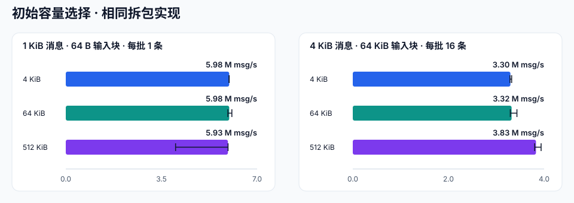

# 收包缓冲与拆包性能

在 2026-10-15 的本机 Release 构建中完成 66 次测量。图表与表格保留全部配置，数据来自独立 C++ 程序。

## 测试环境

| 项目 | 配置 |
| --- | --- |
| 机器 | Mac mini Mac16,11, Apple M4 Pro, 14 核, 48 GiB |
| OS | macOS 27.0.1 (26A434), arm64 |
| 编译器 | Apple clang version 21.0.0 (clang-2100.3.34.2) |
| 构建 | Release (-O3 -DNDEBUG -std=gnu++20 -fPIC), C++20, Boost 1.90.0; arknet 848588e409bf7e5f86bc30b8ffae7efb022eb6e4 |
| 重复与预热 | 3 次；拆包每次预热 10000 批 |

## 结果

10,000 个会话的初始收包缓冲申请量：**5,000 MiB → 39.1 MiB（减少 99.22%）**。这是应用层缓冲数组的容量；socket 缓冲、队列和其他对象另计。

| 消息体 / B | 输入块 / B | 每批消息 | 原实现 / msg/s | 优化实现 / msg/s | 变化 | 原 CPU / % | 优化 CPU / % |
| ---: | ---: | ---: | ---: | ---: | ---: | ---: | ---: |
| 64 | 65536 | 1 | 17,519,100 | 18,455,000 | +5.3% | 100.0 | 100.0 |
| 1024 | 65536 | 1 | 10,460,500 | 10,490,300 | +0.3% | 99.9 | 100.0 |
| 4096 | 65536 | 1 | 4,476,530 | 4,828,650 | +7.9% | 100.0 | 100.0 |
| 1024 | 64 | 1 | 2,374,330 | 5,935,260 | +150.0% | 100.0 | 100.0 |
| 4096 | 1 | 1 | 12,316 | 56,783 | +361.0% | 100.0 | 100.0 |
| 1024 | 64 | 16 | 2,526,070 | 5,684,930 | +125.1% | 99.9 | 100.0 |
| 4096 | 65536 | 16 | 3,932,370 | 3,396,780 | -13.6% | 100.0 | 100.0 |

- 1 KiB / 64 B 输入块：每消息普通对象分配 **18 → 2**。
- 4 KiB / 逐字节输入：每消息普通对象分配 **4098 → 2**。
- 4 KiB / 64 KiB 输入块 / 每批 16 条：吞吐量变化 **-13.6%**，作为内存与吞吐量的取舍保留。

CPU 100% 代表占满一个逻辑核心。程序单线程运行，计时包含消息内容校验。连接容量、网络吞吐量和 RTT 需另做端到端验收。

## 初始容量选择

| 消息体 / B | 输入块 / B | 每批消息 | 初始容量 / KiB | 吞吐量 / msg/s | CPU / % |
| ---: | ---: | ---: | ---: | ---: | ---: |
| 1024 | 64 | 1 | 4 | 5,979,210 | 100.0 |
| 1024 | 64 | 1 | 64 | 5,979,600 | 100.0 |
| 1024 | 64 | 1 | 512 | 5,932,350 | 100.0 |
| 4096 | 65536 | 16 | 4 | 3,295,860 | 100.0 |
| 4096 | 65536 | 16 | 64 | 3,320,350 | 100.0 |
| 4096 | 65536 | 16 | 512 | 3,830,120 | 100.0 |

默认初始容量为 4 KiB，缓冲按需增长。大批量输入可在端点启动前通过 `set_initial_receive_buffer_size(bytes)` 配置较大容量；零值或运行中修改返回 `false`。此容量是应用层拆包缓冲，与 socket 收发缓冲分开设置。

## 复现与原始记录

- [构建与运行参数](../../benchmarks/README_CN.md)
- [原实现数据](../../benchmarks/results/macmini-m4pro-20261015/receive-buffers/before.jsonl) · [优化实现数据](../../benchmarks/results/macmini-m4pro-20261015/receive-buffers/after.jsonl)
- [初始容量对比数据](../../benchmarks/results/macmini-m4pro-20261015/receive-buffers/configurations.jsonl)
- [机器、源码与二进制校验值](../../benchmarks/results/macmini-m4pro-20261015/receive-buffers/metadata.json)
- [原实现提交](https://github.com/OpenArkStudio/ark/commit/1f02377cceba8660af4b0432aa566cad8164e1cb)

对照版本使用同一份基准源码。每轮依次运行原实现、默认容量的优化实现和各容量配置，共三轮；每组独立启动进程，测量期间没有并行编译。
