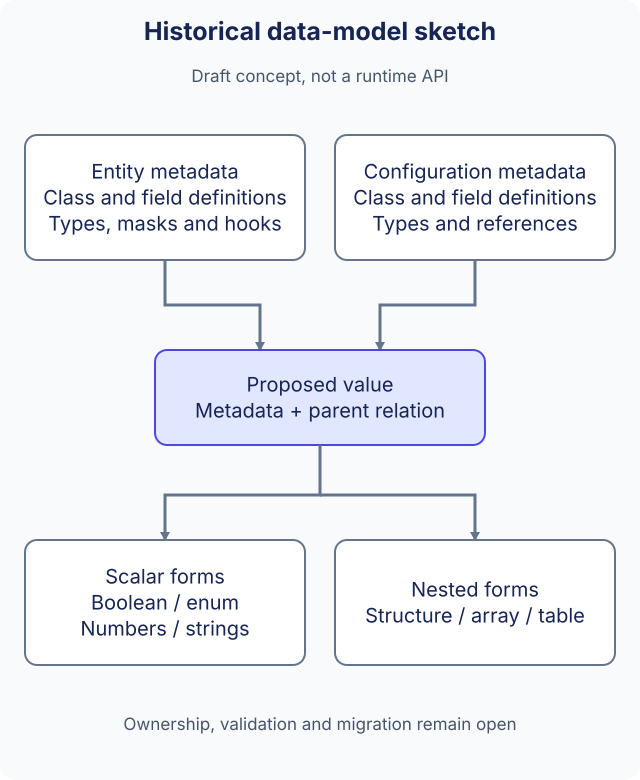

# Data model design notes

<Aside type="note" title="Draft">

This page explains a historical design sketch. Its type names and relationships are proposal vocabulary, not public C++ interfaces or a selected migration plan. Use [data structures](../guides/data-structures.md) and [Kernel](../reference/kernel.md) for current APIs.

</Aside>

## Separate definitions from values

The sketch proposed a general data value with references to class-level and field-level metadata, plus a parent relationship. It split metadata into two purposes:

| Historical name | Intended purpose |
| --- | --- |
| `MetaEntityClassSetting` | A class name and multiple entity-field definitions |
| `MetaConfigClassSetting` | A class name and multiple configuration-field definitions |
| `MetaEntityDataSetting` | A field type, masks and possible function/script behavior |
| `MetaConfigDataSetting` | A field type and references, without entity masks or function behavior |

The proposed value forms included Boolean, enum, numeric and string values, structures keyed by field name, arrays of values and tables keyed by an integer. The sketch's parent pointer described a relationship; it did not define allocation, ownership, cycle prevention or thread safety.

## Relationship to the current model

Current code separates `class_meta`, `node_meta`, `table_meta` and `container_meta` from runtime data. Static configuration records and mutable entities also have separate interfaces. That existing separation is useful context, but it does not make the sketch's general struct/array value, script hooks or metadata hierarchy available as APIs.

The historical names above do not prescribe new public names. They also do not change field indices, stored records, Protobuf numbers or generated identifiers. The original note listed Unreal4 and KFrame as references without a concrete dependency or compatibility contract.

## Questions before implementation

- Which metadata belongs to entity behavior, and which belongs only to reusable configuration values?
- Who owns nested values, and what happens to their parent references during removal, replacement or destruction?
- How do validation, serialization and callbacks handle nested changes and missing references?
- How are existing schemas and saved records migrated without silently changing their meaning?

These questions need a separate design and tests. No business configuration format or migration mechanism is selected here. Continue with the related [nested-data proposal](data-model-proposal.md).

The Chinese [original note](https://github.com/OpenArkStudio/ark/blob/main/docs/site/legacy-source/zh-cn/new-desgin.md) is preserved byte-for-byte in the [source archive](https://github.com/OpenArkStudio/ark/blob/main/docs/site/legacy-source/README.md). This English page is an explanation of that source, not an invented historical translation file.
