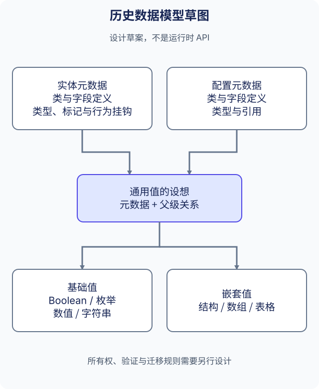

# 数据模型设计说明

<Aside type="note" title="草案">

本页解释历史设计草图，其中的类型名和关系是提案用语，不是公开 C++ 接口，也不代表已确定迁移方案。当前 API 见[数据结构](../guides/data-structures_CN.md)与 [Kernel](../reference/kernel_CN.md)。

</Aside>

## 分开描述定义与值

草图提出一种通用数据值，分别引用类级与字段级元数据，并保留父级关系。元数据按两种用途划分：

| 历史名称 | 设想中的用途 |
| --- | --- |
| `MetaEntityClassSetting` | 类名及多个实体字段定义 |
| `MetaConfigClassSetting` | 类名及多个配置字段定义 |
| `MetaEntityDataSetting` | 字段类型、标记，以及可能的函数或脚本行为 |
| `MetaConfigDataSetting` | 字段类型与引用，不包含实体标记或函数行为 |

设想的值类型包括 Boolean、枚举、数值、字符串、按字段名索引的结构、值数组，以及按整数索引的表格。草图中的父指针只描述关系，没有定义内存分配、所有权、循环引用限制或线程安全。

## 与当前模型的关系

当前代码将 `class_meta`、`node_meta`、`table_meta`、`container_meta` 与运行时数据分开管理，静态配置记录与可变实体也有不同接口。这些已有区分可作为设计背景，但不表示草图中的通用结构或数组值、脚本挂钩和元数据继承体系已成为 API。

上述历史名称不限定未来公开接口的命名，也不改变字段索引、存储记录、Protobuf 编号或生成标识。原笔记列出 Unreal4、KFrame 作为参考，没有确定具体依赖或兼容契约。

## 实现前需要明确的问题

- 哪些元数据属于实体行为，哪些仅描述可复用配置值？
- 嵌套值由谁持有，移除、替换或销毁时如何处理父级引用？
- 验证、序列化与回调如何处理嵌套变化及缺失引用？
- 如何迁移已有定义和保存记录，同时保留原有含义？

这些问题需要单独设计与测试。本页不选择业务配置格式，也不确定迁移机制。相关思路见[嵌套数据提案](data-model-proposal_CN.md)。

中文[原始笔记](https://github.com/OpenArkStudio/ark/blob/main/docs/site/legacy-source/zh-cn/new-desgin.md)逐字节保留在[源码归档](https://github.com/OpenArkStudio/ark/blob/main/docs/site/legacy-source/README.md)中。英文页解释同一来源，不伪造历史英文文件。
